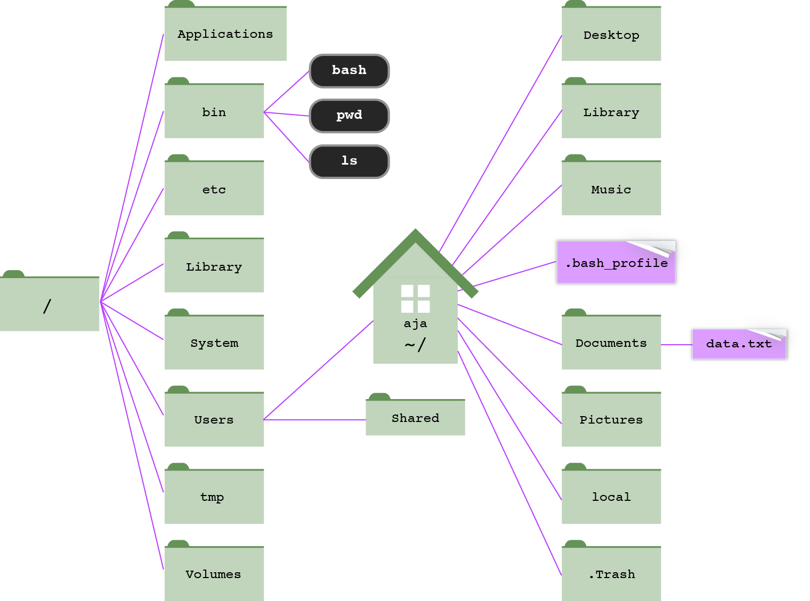

# Introduction to Unix {#unix}

::: {.goals}
**In this chapter**

- why biologists work at the command line, and how to choose an operating system
- how the Unix file system is organized, and how to move around in it
- the core commands for viewing, finding, copying, moving, and deleting files
- how to save, combine, and chain command output with redirection and pipes
- how to slice and summarize data files with `grep`, `cut`, `sort`, `uniq`,
  `awk`, and `sed`
- how to automate repetitive work with Bash scripts and loops
:::

## Why the command line? {#why-command-line}

Why not just point and click with a Graphical User Interface (GUI)? GUIs are
fine for many things, but they fall short for scientific computing:

- They're not good for long sequences of operations that need to be repeated on
  multiple datasets.
- They keep no log of what you did and which commands you ran.
- They're not conducive to running jobs remotely on a computing cluster.
- They're labor-intensive to develop and are generally restricted to a single
  operating system.

Use the command line instead. It's extremely powerful. It might look like a 
primitive interface, but it's not. Learning to work from the command line
requires an up-front investment, but the long-term payoff is enormous:

- It's an absolute necessity for the big datasets that characterize modern
  data science.
- You can automate tasks.
- You can do, and re-do, and re-do analyses with minimal added effort.
- It's easy to record exactly what you did, which minimizes mistakes and makes
  your work repeatable and easier to troubleshoot.

## Choosing an operating system {#choosing-os}

### macOS

**Pros**

- Unix is fully and naturally integrated into the operating system.
- You can still use Microsoft Office, Adobe, and so on.
- It's the easiest transition to make, and the choice of many data scientists.
- It can run most Linux-based software.

**Cons**

- The hardware is expensive, and the operating system is proprietary.
- Python no longer comes pre-installed (Apple removed it in 2022), but it's
  easy to install with conda or Homebrew.
- Some bioinformatics programs aren't yet built for the ARM chips (M1, M2, ...)
  in newer Macs.
- macOS uses the BSD versions of many Unix commands, which occasionally behave
  a little differently from the GNU versions on Linux. This book tries to point
  out the differences that matter (for example, `sed -i` in Section \@ref(sed)).

### Linux

**Pros**

- You can install it as the operating system on any PC. A Linux box is a
  fraction of the price of a comparably outfitted Mac.
- It's compatible with all the important bioinformatics software.
- It's open source.

**Cons**

- It's open source.
- You've probably never used it, so the learning curve is steeper.
- Maintaining a Linux box requires some time investment.

::: {.note}
**An aside: Unix vs. Linux.** Unix is a family of operating systems that dates
back to Bell Labs in the 1970s. macOS is a certified Unix. Linux ("Linus'
Unix," after its creator Linus Torvalds) is a free, open-source, Unix-like
operating system. For the purposes of this course, the commands are nearly
identical. The two differ mostly in how they're developed:

| Unix                                | Linux                                                           |
|-------------------------------------|-----------------------------------------------------------------|
| proprietary                         | open source                                                     |
| targeted development                | diverse development                                             |
| more consistency between versions   | less consistency between versions                               |
| development restrictions            | no restrictions                                                 |
| patches are highly tested           | not as much beta testing                                        |
| more slowly evolving                | huge open-source community identifies and fixes problems quickly |
:::

### Windows

**Pros**

- None.

**Cons**

- Too many to name.
- Windows is not designed for programming and bioinformatics applications.

But there are workarounds for running Linux alongside Windows:

- **Windows Subsystem for Linux (WSL2)** runs a real Linux system inside
  Windows. This is the easiest option for most people
  ([installation guide](https://learn.microsoft.com/en-us/windows/wsl/install)).
- **VMware** runs Linux in a virtual machine
  ([instructions](https://uark-my.sharepoint.com/:f:/g/personal/datasci_uark_edu/EjgLZ3UcpBtPlcSOrL9TP8IBIFjWxif-0w7uTY900w8RjQ?e=A4VctH)).
- **Log into a remote Linux computer**, such as the university's computing
  cluster (Chapter \@ref(remote)). Windows 10 and 11 include an `ssh` command
  that you can run in PowerShell or Windows Terminal.
  [PuTTY](https://www.putty.org/) is an older alternative.
- **Boot Linux from a flash drive** (e.g., with
  [UNetbootin](http://unetbootin.sourceforge.net/)). You have to restart your
  computer to switch operating systems.

## The Shell {#shell}

You interact with Unix through a **shell**, which is:

- an intermediary between you and the inner workings of the operating system
- a *command interpreter*, providing an interface to programs and utilities
- a *programming language*, letting you combine utilities in different ways to
  get things done

A shell can be used interactively, accepting commands you type on the keyboard,
or non-interactively, reading commands from a file (a *script*). A shell can:

- run **builtin commands** implemented inside the shell itself, such as
  `cd`, `pwd`, and `exit`;
- run **programs installed elsewhere** on the file system, such as the
  [GNU Core Utilities](https://www.gnu.org/software/coreutils/) (`ls`, `mv`,
  `rm`, `mkdir`, `chmod`, ...). Section \@ref(path) explains how the shell
  finds them.

There are many different shells. We'll use **Bash** or **Zsh**, which has been
the default shell on macOS since 2019. For everything in this course, the two
behave the same way. The shell runs inside a text window: on a Mac, that's the
**Terminal** application.

- Launch Terminal: *Finder > Go > Utilities > Terminal*.
- Add Terminal to your Dock by dragging and dropping it there. You'll be using
  it a lot.

When the shell is ready for a command, it shows a **prompt**, often ending in
`$` or `%`. Type a command and press <kbd>Return</kbd>. Start with these:

```{bash}
whoami        # what's my user name?
echo $SHELL   # which shell am I using?
echo $HOME    # where's my home directory?
```

Anything after a `#` is a **comment**; the shell ignores it. This book uses
comments to explain what commands do.

## The file system {#file-system}

Your computer's files are organized like a filing cabinet: drawers (folders)
hold files and other folders. In Unix, folders are called **directories**, and
they're organized into a tree that starts at a single **root directory**,
written as a forward slash: `/`.

```{r directory-structure, echo = FALSE, out.width = "90%", fig.cap = "Part of the directory structure on a Mac. Everything branches from the root directory (`/`). The user aja's home directory (`~`) is inside `/Users`. Modified from Haddock & Dunn, [*Practical Computing for Biologists*](#references)."}

```

Every user has a **home directory** where their own files live. On a Mac, it's
`/Users/username`. The shell uses `~` as shorthand for your home directory.

::: {.note}
**Reading.** [*File not found*](https://www.theverge.com/22684730/students-file-folder-directory-structure-education-gen-z)
by Monica Chin (*The Verge*), on why a generation raised on search bars has
never needed to think about directories, and why that's a problem for
scientists.
:::

### Paths {#paths}

A **path** is a written description of a location in the file system. Both
directories and files have paths. A path is a series of directory names
separated by forward slashes (`/`).

- An **absolute path** gives the complete, unambiguous location of a file,
  starting from the root. It always starts with a forward slash:

  `/Users/aja/Desktop/files/data/watermelon_genome/watermelon.fsa`

- The **working directory** is where you are right now.

- A **relative path** describes where a file or directory is relative to some
  other directory, usually the working directory. If you're in `~/Desktop`,
  the relative path to `watermelon.fsa` is:

  `files/data/watermelon_genome/watermelon.fsa`

A few special names help you write paths:

| Name | Meaning                                         |
|------|-------------------------------------------------|
| `/`  | the root directory (at the start of a path)     |
| `~`  | your home directory                             |
| `.`  | the current (working) directory                 |
| `..` | the parent directory, one level up              |

::: {.tip}
**Mac shortcut.** You can enter a long path to a file by dragging the file from
the Finder and dropping it into the Terminal window. Try it with
`files/file_types/Don't do this.txt`.
:::

::: {.warning}
**New rule: no spaces in file names.** Look at what happened when you dragged
`Don't do this.txt` into the Terminal: the shell needs backslashes to "escape"
the spaces and the apostrophe, because spaces are reserved for separating the
parts of a command. Spaces (and other special characters, like parentheses and
apostrophes) in file names cause endless trouble at the command line. 
Instead, use:

- underscores or dashes: `my_file.txt`, `my-file.txt`
- camelCase (mixed upper and lowercase): `myFile.txt`
- dots: `my.file.txt`
:::

### The course files {#course-files}

Download [`files.tgz`](https://andrewalverson.github.io/practical-programming-for-biologists/files.tgz) and move it to your Desktop.
A `.tgz` file is a compressed archive (a "tarball"), similar to a `.zip` file.
Double-click it in the Finder, or extract it at the command line (Section
\@ref(tar) explains how this works):

```{bash, eval = FALSE}
cd ~/Desktop
tar -xzf files.tgz
```

This creates a `files` directory. We'll work mostly with the data in
`files/data`:

```{bash}
ls
```

The examples in this book assume you've extracted `files.tgz` on your
Desktop. If you put it somewhere else, adjust the paths accordingly.

::: {.exercise}
Using the directory tree in Figure \@ref(fig:directory-structure) and the
layout of the course files:

1. Write the absolute path to `fruit.txt` (in `files/data`) on your computer.
2. Write the relative path to `fruit.txt` from your home directory.
3. You're in `files/data/watermelon_genome/nt`. Write the relative path to
   `fruit.txt` using `..`.
4. Write the path to the `bin` directory that holds `ls` and `pwd` in the
   figure. Is it absolute or relative?
:::

## Getting around {#getting-around}

### `pwd`, `cd`, and `echo`

`pwd` **p**rints the path of the **w**orking **d**irectory. Is it an absolute
or a relative path?

```{bash, eval = FALSE}
pwd
```

`cd` **c**hanges **d**irectory:

```{bash, eval = FALSE}
cd ~/Desktop/files/data/watermelon_genome            # relative to home (~)
cd /Users/aja/Desktop/files/data/watermelon_genome   # absolute path
cd ..                                                # move up one directory
cd ../..                                             # move up two directories
cd                                                   # go home
cd ~                                                 # also go home
cd -                                                 # go back to the previous directory
```

`echo` writes its arguments to the screen (more precisely, to *standard
output*, Section \@ref(data-streams)):

```{bash}
echo crazy
echo crazy horse
```

### `clear` and `exit`

`clear` clears the Terminal screen. `exit` ends your shell session.

::: {.warning}
**Exit before you quit.** Always `exit` your session before closing the
Terminal window. Not doing so is like unplugging your computer: an
unceremonious end to all your programs and processes.
:::

::: {.tip}
**Awesome shortcuts.**

- <kbd>Tab</kbd>: auto-complete file and command names. Use it constantly; it
  saves typing and prevents typos. Press it twice to see all the possible
  completions.
- <kbd>↑</kbd> and <kbd>↓</kbd>: scroll through and re-run previous commands.
- <kbd>Ctrl</kbd>+<kbd>r</kbd>: search for an old command.
- `history`: list your previous commands.
- `open .` (Mac only): open the working directory in the Finder.

**More shortcuts.**

- <kbd>Ctrl</kbd>+<kbd>a</kbd>: go to the beginning of the command.
- <kbd>Ctrl</kbd>+<kbd>e</kbd>: go to the end of the command.
- <kbd>Ctrl</kbd>+<kbd>u</kbd>: erase from the cursor to the start of the
  command.
- <kbd>Ctrl</kbd>+<kbd>l</kbd>: clear the screen (same as `clear`).
:::

### Stopping a command: <kbd>Ctrl</kbd>+<kbd>C</kbd> {#ctrl-c}

Sooner or later, you'll start a command that won't stop: it's printing an
entire genome to the screen, it's taking far longer than expected, or it's
just sitting there with no prompt. Don't close the Terminal window. Instead:

| Keys                          | What it does                                                         |
|-------------------------------|----------------------------------------------------------------------|
| <kbd>Ctrl</kbd>+<kbd>C</kbd>  | **cancel** (interrupt) the running command and get your prompt back  |
| <kbd>Ctrl</kbd>+<kbd>D</kbd>  | signal "end of input" to a command that's waiting for you to type    |
| <kbd>q</kbd>                  | quit programs like `less` and `man` that take over the whole screen  |

A command with no prompt is often *waiting for input*. If you forget to give
`cat` or `grep` a file name, for example, it waits for you to type the input
on the keyboard (that's STDIN, Section \@ref(data-streams)).

::: {.exercise}
1. Type `cat` with no file name and press <kbd>Return</kbd>. Type a few
   words and press <kbd>Return</kbd>. What happens? Press
   <kbd>Ctrl</kbd>+<kbd>D</kbd>.
2. Run `cat` again, and this time get out with <kbd>Ctrl</kbd>+<kbd>C</kbd>.
3. Run `yes`, a command that prints `y` forever. Stop it.
:::

### `ls`: listing directory contents {#ls}

`ls` **l**i**s**ts the contents of a directory. With no arguments, it lists the
working directory. Otherwise, give it the path to a directory or file:

```{bash, eval = FALSE}
ls                                      # contents of the working directory
ls ~/Desktop                            # contents of the Desktop
ls ~/Desktop/files/data/watermelon_genome
ls ~/Desktop/files/data/watermelon_genome/watermelon.fsa
```

From here on, most examples are run from inside the `watermelon_genome`
directory:

```{bash, eval = FALSE}
cd ~/Desktop/files/data/watermelon_genome
```

```{bash, dir = "watermelon_genome"}
ls
```

Most Unix commands take **options** (also called *flags* or *arguments*) that
modify their behavior. Options start with a dash. Useful options for `ls`:

| Option | Effect                                                    |
|--------|-----------------------------------------------------------|
| `-a`   | list **a**ll contents, including hidden files             |
| `-l`   | **l**ong format                                           |
| `-h`   | **h**uman-readable file sizes (with `-l`)                 |
| `-t`   | sort by **t**ime modified, most recent first              |
| `-S`   | sort by file **S**ize, largest first                      |

Single-letter options can be given separately or combined. These are all the
same command:

```{bash, eval = FALSE}
ls -a -l
ls -al
ls -la
```

Add more options to sort by size and show human-readable sizes:

```{bash, dir = "watermelon_genome"}
ls -alSh
```

Files whose names start with a dot (like `.DS_Store`) are **hidden files**;
plain `ls` doesn't show them. `.` and `..` are links to the current and parent
directories.

### Reading `ls -l` output

Each line of a long listing describes one file or directory:

```text
-rw-------  1 aja  staff   371K Aug 21  2023 watermelon.fsa
```

| Field            | Meaning                                                            |
|------------------|--------------------------------------------------------------------|
| `-`              | file type: `-` for a file, `d` for a directory, `l` for a link     |
| `rw-------`      | permissions for the user, group, and others (Section \@ref(chmod)) |
| `1`              | number of links (for directories, roughly how many items inside)   |
| `aja`            | the file's owner                                                   |
| `staff`          | the owner's user group                                             |
| `371K`           | file size                                                          |
| `Aug 21  2023`   | date and time last modified                                        |
| `watermelon.fsa` | file name                                                          |

### Wildcards {#wildcards}

A **wildcard** stands in for other characters in a file name. The most
important one is `*`, the wildest of all wildcards: it matches any number of
any characters (except a slash).

```{bash, dir = "watermelon_genome"}
ls *.gff         # every file that ends in .gff
ls nt/cox*       # every file in nt/ that starts with cox
```

```{bash, dir = "watermelon_genome"}
ls -l */nad1*    # nad1 files in any subdirectory
```

Two less common wildcards are sometimes handy: `?` matches exactly one
character, and `[...]` matches any one of the characters inside the brackets.

```{bash, dir = "watermelon_genome"}
ls nt/atp?.fasta       # atp followed by exactly one character
ls nt/cox[13].fasta    # cox1 or cox3
```

::: {.exercise}
From inside `watermelon_genome`:

1. Show a long listing of all the *atp* genes in the `aa` directory.
2. How would you show the file sizes of those genes in bytes? In kilobytes?
3. List all the ribosomal protein genes (*rps* and *rpl*) in `nt`.
4. List all the genomes in `mt_genomes` that contain a "u" in the file name.
5. Based on file size, which is the largest genome in `mt_genomes`?
6. Which file in `watermelon_genome` was modified most recently?
:::

### Finding files: `find` {#find}

`ls` shows you what's in one directory. `find` searches a directory *and
everything below it*. Its structure is `find where tests`:

| Test                 | Finds                                               |
|----------------------|-----------------------------------------------------|
| `-name 'pattern'`    | names matching a pattern (wildcards allowed)        |
| `-iname 'pattern'`   | the same, but ignoring upper/lowercase              |
| `-type f`            | files only                                          |
| `-type d`            | directories only                                    |
| `-size +500k`        | files bigger than 500 kilobytes (`M` for megabytes) |
| `-mtime -7`          | files modified in the last 7 days                   |

```{bash}
find . -name '*.csv'                      # all CSV files, starting here (.)
```

```{bash}
find . -type d                            # all directories
```

```{bash}
find watermelon_genome -name 'nad1*'      # every nad1 file under watermelon_genome
```

```{bash}
find . -type f -size +700k                # big files
```

Put the pattern in quotes. Without them, the shell expands the wildcard
*before* `find` sees it (Section \@ref(quoting)).

::: {.exercise}
Starting from the `files` directory:

1. Find every FASTA file (ending in `.fasta`) anywhere below `files`. How many
   are there? (Hint: you'll be able to count them easily after Section
   \@ref(pipes). For now, just look.)
2. Find all the Python scripts (`.py`).
3. Find all the files larger than 1 megabyte.
:::

## Looking at files {#viewing-files}

### `cat`

`cat` con**cat**enates files and prints them to the screen. Give it one file
to view it, or several to print them one after another:

```{bash, dir = "watermelon_genome"}
cat nt/atp9.fasta
```

```{bash, eval = FALSE}
cat file1 file2 file3
```

::: {.exercise}
A colleague asks you to send her a single file with all the watermelon *nad*
gene sequences, both amino acids and nucleotides. How would you do it? How long
would it take for one species? 5 species? 100 species? 1,000 species?
:::

### `head` and `tail`

`head` shows the first 10 lines of a file and `tail` shows the last 10. Both
are good for peeking at large files. Use `-n` to choose how many lines:

```{bash, dir = "watermelon_genome"}
head -n 3 watermelon.gff
```

### `less` {#less}

`less` lets you page through a file of any size without printing the whole
thing to the screen. It has more features than its predecessor `more`
(because *less is more*).

```{bash, eval = FALSE}
less watermelon.fsa
```

Inside `less`:

| Key                                          | Action                             |
|----------------------------------------------|------------------------------------|
| <kbd>Space</kbd>, <kbd>↑</kbd>, <kbd>↓</kbd> | move through the file              |
| `/search-term`                               | search for `search-term`           |
| <kbd>n</kbd> / <kbd>N</kbd>                  | next / previous match              |
| <kbd>g</kbd> / <kbd>G</kbd>                  | go to the top / bottom of the file |
| <kbd>q</kbd>                                 | quit                               |

`less` has lots of options. Three good ones:

| Option | Effect                                  |
|--------|-----------------------------------------|
| `-i`   | ignore case when searching              |
| `-S`   | do **not** wrap (fold) long lines       |
| `-N`   | show line numbers                       |

```{bash, eval = FALSE}
less -iSN watermelon.gff
```

::: {.exercise}
Open `watermelon.gff` with `less -iSN`.

1. Jump to the bottom of the file. How many lines does it have?
2. Search for `trnM`. How many hits are there?
3. Use the arrow keys to scroll right and see the end of the long lines.
:::

### Getting help: `man` {#man}

There are two main ways to find help. The first is the **manual pages**, which
describe a program's usage and all its options:

```{bash, eval = FALSE}
man ls
```

You navigate and search a man page just like a file in `less`; press
<kbd>q</kbd> to exit. Man pages are usually straightforward, but not always.
The second way is to search the web, which is often faster.

::: {.note}
**Getting help from AI assistants.** Chatbots such as ChatGPT, Claude, and
Copilot are good at explaining what an unfamiliar command does and at
suggesting commands for a task. Use them, but:

- Ask for an explanation of every part of a command you don't understand, and
  check it against the man page.
- Test suggested commands on copies of your data (in `/tmp`, for example)
  before running them on the real thing. Be especially careful with anything
  that uses `rm`, `mv`, `>`, `sed -i`, or a loop over many files.
- You're responsible for what you run, not the chatbot.
:::

::: {.exercise}
Use `man ls` to find the options that:

1. list one file per line;
2. reverse the order of the listing.

Then list `watermelon_genome/nt`, one file per line, in reverse alphabetical
order.
:::

## Data streams and redirection {#data-streams}

Every Unix command has three standard data streams:

| Number | Name                     | What it is                                                                  |
|--------|--------------------------|-----------------------------------------------------------------------------|
| 0      | standard input (STDIN)   | input to a command: what you type, or a file redirected in with `<`         |
| 1      | standard output (STDOUT) | the results the command prints to your screen                              |
| 2      | standard error (STDERR)  | error messages the command prints to your screen                            |

By default, both STDOUT and STDERR go to the screen. What if we want to save
them?

### Redirecting STDOUT

Use `>` to send STDOUT to a file instead of the screen:

```{bash, eval = FALSE}
ls -al > contents.txt
cat nt/nad*.fasta > nad_genes.fasta
```

Use `>>` to *append* to the end of an existing file:

```{bash, eval = FALSE}
echo 'directory listing' > dir.out
ls -al >> dir.out
```

::: {.warning}
**`>` overwrites.** If you redirect with a single `>` to a file that already
exists, the shell completely overwrites it, without warning.
:::

::: {.note}
**End files with a newline.** Before combining lots of files with `cat`, make
sure each file ends with a newline character. Otherwise, the first line of one
file will be glued onto the last line of the file before it.
:::

::: {.exercise}
1. Write all the *nad* nucleotide sequences to a file.
2. Now write all the *nad* amino acid sequences to the same file, without
   overwriting the nucleotide sequences.
3. Create a single file, `~/Desktop/watermelon_data.fasta`, with the following
   data, in this order:
   - the watermelon genome (`mt_genomes/citrullus_lanatus.fasta`)
   - all the watermelon nucleotide sequences
   - all the watermelon amino acid sequences
:::

### Redirecting STDERR

STDERR is data stream number 2, so use `2>` to send it to a file. Here, one
file exists and the other doesn't, so we get both STDOUT and STDERR:

```{bash, dir = "watermelon_genome", error = TRUE}
ls -l watermelon.fsa nada.txt
```

```{bash, eval = FALSE}
ls -l watermelon.fsa nada.txt > listing.txt 2> err.txt  # STDOUT and STDERR to separate files
ls -l watermelon.fsa nada.txt 2> err.txt                # STDOUT to the screen, STDERR to a file
ls -l watermelon.fsa nada.txt 2>> err.txt               # append STDERR to a file
```

Sometimes you want to throw output away entirely. `/dev/null` is a "black
hole": anything redirected there disappears.

```{bash, dir = "watermelon_genome", error = TRUE}
ls -l watermelon.fsa nada.txt > /dev/null   # discard STDOUT; only the error is shown
```

This is handy for programs that print huge amounts of output you don't need,
while you save their error messages to a log file.

::: {.exercise}
1. With a single command, create a file named `atp.fa` in your home directory
   containing, in order, the watermelon *atp* nucleotide sequences and then the
   *atp* amino acid sequences.
2. Run `ls -l watermelon.fsa nada.txt` again, this time sending STDOUT to
   `/dev/null` and STDERR to a file named `errors.log`. What's on the screen?
   What's in `errors.log`?
:::

## Text files and text editors {#text-files}

### Plain text

Programs and data for this course are **plain text** files. *No Microsoft Office
documents.* Compare a GFF file saved as plain text with the same content saved
as a Word document:

```{bash, eval = FALSE}
cd ~/Desktop/files/file_types
less -S watermelon.gff
less -S watermelon.gff.docx
```

The `file` command tells you what kind of file you have:

```{bash, dir = "../file_types"}
file *
```

Free alternatives to Microsoft Office, such as
[LibreOffice](https://www.libreoffice.org/), tend not to introduce weirdness
into files the way Microsoft products do.

### Line breaks matter

Different operating systems mark the end of a line with different invisible
characters:

| Character(s) | Name                          | Used by                                   |
|--------------|-------------------------------|-------------------------------------------|
| `\n`         | newline (line feed, LF)       | Unix, Linux, and macOS                    |
| `\r\n`       | carriage return + newline     | Windows                                   |
| `\r`         | carriage return (CR)          | classic Mac OS (before 2001)              |

Today, the line breaks you'll run into most often are Windows-style `\r\n`,
in files from Windows users or exported from Windows programs. Old-style Mac
`\r` line breaks still turn up in files from older software. Notice the `CR
line terminators` in the `file` output above, and look at what `wc -l` (which
counts `\n` characters) thinks of those files:

```{bash, dir = "../file_types"}
wc -l watermelon.gff watermelon.mac.gff
```

Look at the two versions yourself:

```{bash, eval = FALSE}
less watermelon.gff
less watermelon.mac.gff
```

`less` shows the carriage returns as `^M`, and the whole file appears as one
long line. If a program can't read a file, or dies without running, check the
line breaks. Many text editors can change line breaks with "Save As," and the
`tr` (**tr**anslate characters) command can fix them at the command line:

```{bash, sandbox = TRUE, dir = "../file_types"}
tr '\r' '\n' < watermelon.mac.gff > watermelon.fixed.gff   # old Mac: replace \r with \n
wc -l watermelon.fixed.gff
```

```{bash, eval = FALSE}
tr -d '\r' < windows_file.txt > fixed_file.txt             # Windows: delete the \r
```

`tr` only reads from STDIN, so the input file is redirected in with `<`.
Later in the course, we'll also write a Python script to fix line breaks.

### Text editors

You'll need a good text editor for writing scripts and editing data files:

- **nano** ("nano's another editor"): quick and dirty text editing right in
  the Terminal. Run `nano filename`; the commands are listed at the bottom of
  the screen (`^` means <kbd>Ctrl</kbd>).
- **[Visual Studio Code](https://code.visualstudio.com/)**: free and excellent
  for programming. This is what we'll use in class.
- **[BBEdit](https://www.barebones.com/products/bbedit/)** (Mac): an
  all-around workhorse for text editing, with good features for programming.
  Open files from the command line with `bbedit filename`.

### Fonts

Get used to reading and writing code in a **monospace** (fixed-width) font,
such as Courier, Menlo, or Monaco, where every character takes up the same
amount of space. In a proportional font, characters have different widths, so
things that should line up don't, which matters a lot for sequence alignments:

<table style="width:auto; margin: 1em auto;">
<tr><th style="padding:0 2em;">Proportional</th><th style="padding:0 2em;">Monospace</th></tr>
<tr>
<td style="padding:0.4em 2em; font-family: Georgia, serif; font-size:1.3em; line-height:1.2;">AAAccgGTT<br>|||||||||<br>AAG&#45;&#45;TAAC</td>
<td style="padding:0.4em 2em; font-family: Menlo, Monaco, Courier, monospace; font-size:1.3em; line-height:1.2;">AAAccgGTT<br>|||||||||<br>AAG&#45;&#45;TAAC</td>
</tr>
</table>

::: {.exercise}
1. Use `nano` to create a file called `my_genes.txt` listing three of your
   favorite genes, one per line. Save it and exit.
2. View it with `cat`, then count its lines with `wc -l` (Section
   \@ref(wc)). Does the count match what you expect? (If you didn't press
   <kbd>Return</kbd> after the last gene, it won't. Why?)
:::

## Managing files and directories {#managing-files}

```{r danger, echo = FALSE, out.width = "22%"}

```

::: {.warning}
**Really important warnings.**

- Unix commands are permanent.
- There is no Trash or Recycle Bin.
- There are usually no warnings.
- If you overwrite a file, it's gone forever.
- If you delete a file, it's gone forever.

Use the `-i` flag with `cp`, `mv`, and `rm` until you're comfortable. It makes
the command ask for confirmation before overwriting or removing anything.
:::

**Back up your data.** If you don't, and you lose it, it's your own fault.

- Use Box, Google Drive, OneDrive, or Dropbox. Mac users: also use Time Machine.
- Have at least two backups of your important files. These backups should be in
  different physical locations.
- Make copies of your files before doing something drastic.
- Make dummy files and folders and test your commands on those first. The
  `/tmp` directory is a good place for this.
- You can do real and permanent damage with the commands you learn in this
  course.

### Copying and moving: `cp` and `mv`

`cp` **c**o**p**ies a file: `cp source target`.

```{bash, eval = FALSE}
cd ~/Desktop/files/data/watermelon_genome
cp watermelon.fsa copy.fasta                    # copy within the same directory
cp watermelon.fsa ~/Documents/copy.fasta        # copy to another directory
cd
cp ~/Desktop/files/data/watermelon_genome/copy.fasta ~/Documents/second_copy.fasta
cp ~/Desktop/files/data/watermelon_genome/copy.fasta ~/Documents   # keep the same name
```

To copy a directory and everything in it, add `-r` (**r**ecursive). Without
it, `cp` refuses to copy directories:

```{bash, eval = FALSE}
cp -r nt nt_backup                 # copy the nt directory and all its files
cp -r nt ~/Desktop/                # copy it to the Desktop, keeping its name
```

`mv` **m**o**v**es or renames a file or directory: `mv source target`. Unlike
`cp`, it works on directories without `-r`.

```{bash, eval = FALSE}
mv copy.fasta junk.dat                 # rename a file
mv junk.dat /tmp/tmp.fas               # move and rename
mv watermelon_genome /tmp              # move a whole directory
mv /tmp/watermelon_genome .            # move it back here (.)
```

### Making directories: `mkdir`

`mkdir` **m**a**k**es one or more **dir**ectories:

```{bash, eval = FALSE}
mkdir cowgirl
mkdir cowgirl in the sand    # makes four directories: cowgirl, in, the, sand
ls -al
```

What happened with the second command, and why? (Remember the rule about
spaces in file names.)

`mkdir -p` (**p**arents) creates a whole path of nested directories at once,
and doesn't complain if a directory already exists:

```{bash, sandbox = TRUE}
mkdir -p project/data/raw
mkdir -p project/results
find project
```

### Deleting: `rm` and `rmdir`

`rm` **r**e**m**oves files:

```{bash, eval = FALSE}
rm ~/Documents/second_copy.fasta
rm ~/Documents/copy.fasta
```

`rmdir` removes directories, but only empty ones, which makes it of limited
use. To remove a directory *and everything in it*, use `rm -r`
(**r**ecursive):

```{bash, eval = FALSE}
rm -r cowgirl     # removes all the files in cowgirl, then cowgirl itself
```

::: {.warning}
**`rm -r` is dangerous.** It's a very dangerous command that you will use all
the time. Double-check what you're deleting before you press
<kbd>Return</kbd>, and consider using `rm -ri` until you're comfortable.
:::

### Links: `ln` {#ln}

`ln -s` makes a **symbolic link** to a file or directory, similar to an alias
or shortcut:

```{bash, eval = FALSE}
ln -s filename              # link has the same name as the file
ln -s filename link-name    # link has a new name
ln -s directory link-name   # links work for directories, too
```

- Opening or editing the link opens or edits the actual file being linked to.
- You can link to links.
- Links keep you from having lots of copies of the same file sitting around,
  which becomes a real problem when you start editing them. (Which one is the
  real `FINAL_ANALYSES`?)
- Use `unlink` or `rm` to remove a link. This removes only the link, not the
  file it points to.

### How much space? `du` and `df`

`du` (**d**isk **u**sage) reports how much space files and directories take
up. `-s` gives a **s**ingle total for each argument, and `-h` makes the sizes
**h**uman-readable:

```{bash}
du -sh watermelon_genome/*
```

`df -h` (**d**isk **f**ree) shows how full each disk is. Both commands become
important on a shared computing cluster, where your storage space is limited
(Chapter \@ref(remote)).

::: {.exercise}
Do this in `/tmp` so nothing important is at risk.

1. In a single command, create the directories `biol5153/data`,
   `biol5153/scripts`, and `biol5153/results`.
2. Copy the whole `watermelon_genome/nt` directory into `biol5153/data`.
3. Rename `biol5153/data/nt` to `biol5153/data/nucleotide`.
4. Make a symbolic link named `genes` in `biol5153` that points to
   `biol5153/data/nucleotide`. List the contents of `biol5153/genes`.
5. How much space does `biol5153` take up?
6. Delete the whole `biol5153` directory, using `-i` so you're asked about each
   file. (Press <kbd>Ctrl</kbd>+<kbd>C</kbd> when you get tired of
   answering, then do it without `-i`.)
:::

## Working with data {#working-with-data}

Now the fun starts. A handful of small Unix tools, each doing one thing well,
can answer a surprising number of questions about your data. The examples in
this section use the small files in `files/data`, so move there first:

```{bash, eval = FALSE}
cd ~/Desktop/files/data
```

### `wc`: counting {#wc}

`wc` counts lines, words, and characters (bytes):

```{bash}
wc fruit.txt      # lines, words, and bytes
wc -l fruit.txt   # lines only
```

`wc -m` counts characters.

::: {.exercise}
How many lines are in `fruit.txt`? How many songs are on `cowboy_carter.txt`?
How many lines are in `shaver_etal.csv`, and how many data records does that
mean? (Look at the first line.)
:::

### `sort`: sorting {#sort}

`sort` sorts the lines of a text file. Here's the file we'll sort:

```{bash}
cat fruit.txt
```

Useful options:

| Option | Effect                                         |
|--------|------------------------------------------------|
| `-k`   | which column (**k**ey) to sort by              |
| `-g`   | **g**eneral numeric sort                       |
| `-r`   | **r**everse the order (descending)             |
| `-t`   | the character that separates columns (default: whitespace) |

```{bash}
sort -k2 fruit.txt     # sort by the second column
```

```{bash}
sort -k1gr fruit.txt   # sort by the first column, numerically, in reverse
```

Without `-g`, numbers are sorted alphabetically, so `10` comes before `9`.

::: {.exercise}
1. Sort `fruit.txt` by state (column 3).
2. Sort `watermelon_genome/watermelon.gff` by feature size (column 6), largest
   first. (Hint: `watermelon.gff` is tab-delimited, and column 1 contains a
   space. Use `-t $'\t'` to tell `sort` that columns are separated by tabs.)
:::

### `grep`: searching {#grep}

`grep` prints the lines of a file that match a pattern. The name comes from the
`ed` text editor command `g/re/p`: **g**lobally search for a **r**egular
**e**xpression and **p**rint. It's extremely powerful, and one of the most
useful tools in the Unix bioinformatics toolbox.

```{bash}
grep apple fruit.txt        # lines containing "apple"
```

```{bash}
grep -i mi fruit.txt        # case-insensitive
```

```{bash}
grep -v apple fruit.txt     # lines that do NOT contain "apple"
```

Common options:

| Option    | Effect                                                           |
|-----------|------------------------------------------------------------------|
| `-c`      | show only a **c**ount of the matching lines                      |
| `-v`      | show only the lines that do *not* match (in**v**ert)             |
| `-f file` | read the patterns to search for from a **f**ile, one per line    |
| `-i`      | case-**i**nsensitive matching                                    |
| `-w`      | match whole **w**ords only                                       |
| `-x`      | match whole lines only (the line must be e**x**actly the pattern) |
| `-F`      | treat patterns as **f**ixed text, not regular expressions        |
| `-E`      | use **e**xtended regular expressions (more on this later)        |
| `-l`      | **l**ist only the names of files containing matches              |
| `-n`      | show the line **n**umbers of matches                             |
| `-h`      | **h**ide file names in the output (when searching several files) |
| `-o`      | show **o**nly the matching part of each line                     |
| `-B 2`    | also print 2 lines **b**efore each match                         |
| `-A 2`    | also print 2 lines **a**fter each match                          |
| `--color` | highlight the matches                                            |

In a FASTA file, every sequence starts with a header line that begins with
`>`. So `grep` is a quick way to see or count the sequences in a file:

```{bash}
grep '>' watermelon_genome/nt/cox1.fasta
```

```{bash}
grep -c '>' watermelon_genome/mt_genomes/*.fasta | head -n 4
```

::: {.warning}
**Be careful with `grep` and FASTA files.** Always put `>` in quotes. Without
them, the shell treats `>` as a redirect, and `grep > all_seqs.fasta` will
silently overwrite `all_seqs.fasta` with nothing.
:::

#### Searching for many patterns at once: `grep -f` {- #grep-f}

What if you have a list of 50 genes and want every line in a GFF file that
mentions any of them? Instead of running `grep` 50 times, put the patterns in
a file, one per line, and give the file to `grep` with `-f` (**f**ile). This is
how you "grep one file against another."

```{bash, sandbox = TRUE}
printf 'cox1\nnad5\natp9\n' > genes_of_interest.txt   # make a list of genes
cat genes_of_interest.txt
```

```{bash, sandbox = TRUE}
grep -f genes_of_interest.txt watermelon_genome/watermelon.gff | cut -f 3-5,9
```

(In real life, your list would come from another analysis or a collaborator.
`printf` just makes a quick example; `\n` is a newline.)

`grep -f` matches a pattern *anywhere* in a line, which can catch more than
you intended. Two options fix most problems:

- **`-w`**: whole words only. Searching for `nad4` also finds `nad4L`, but
  `grep -w` doesn't:

  ```{bash, dir = "watermelon_genome"}
  ls nt | grep nad4
  ```

  ```{bash, dir = "watermelon_genome"}
  ls nt | grep -w nad4
  ```

- **`-x`**: whole lines only. Use it to compare two lists, such as two lists
  of gene names, or (here) a playlist against an album's track list:

  ```{bash, sandbox = TRUE}
  printf "TEXAS HOLD 'EM\nJOLENE\nII MOST WANTED\nPURPLE RAIN\n" > playlist.txt
  grep -f playlist.txt cowboy_carter.txt     # matches anywhere in the line
  ```

  `JOLENE` matched `DOLLY P / JOLENE`, and `TEXAS HOLD 'EM` matched
  `SMOKE HOUR WILLIE NELSON / TEXAS HOLD 'EM`. With `-x`, only exact,
  whole-line matches count:

  ```{bash, sandbox = TRUE}
  grep -x -f playlist.txt cowboy_carter.txt  # whole lines only
  ```

Add `-v` to get the lines that *don't* match any pattern. With two lists, that
answers "what's in this list but not that one?":

```{bash, sandbox = TRUE}
grep -v -x -f cowboy_carter.txt playlist.txt   # songs on the playlist that aren't on the album
```

Notice the order: the file after `-f` holds the patterns, and the last file is
the one being searched.

::: {.warning}
**Clean pattern files.** A few things in a pattern file cause silent trouble:

- **Blank lines.** On many systems, including Linux and the cluster, an empty
  pattern matches *every* line. Check for a blank line at the end of the file.
- **Windows line endings.** Each pattern ends with an invisible `\r` that
  won't match anything (Section \@ref(text-files)). Fix the file with `tr -d
  '\r'`.
- **Special characters.** `grep` treats patterns as regular expressions (more
  on these later), where characters like `.`, `(`, and `*` have special
  meanings. If your patterns are plain names, add `-F` to treat them as fixed
  text, for example when searching for tRNA names like `trnN(GTT)`.
:::

::: {.exercise}
1. `shaver_etal.csv` contains plant data from four Arctic sites
   ([Shaver et al. 2013](#references)).
   Use `grep` to find:
   - just the Toolik Lake data
   - everything *but* the Toolik Lake data
   - only the June data
2. How many lines of `shaver_etal.csv` contain Toolik Lake data? (Use one
   `grep` command, no other tools.)
3. Make a single file with all the watermelon nucleotide sequences, called
   `genes.fa`. Use `grep` to count the sequences in it.
4. Which files in `watermelon_genome/nt` contain the EcoRI restriction site
   `GAATTC`? List just the file names.
5. Make a file, `my_genes.txt`, listing `atp1`, `cox2`, `nad4`, and `rps3`,
   one per line. Use `grep -f` to print every line of `watermelon.gff` that
   mentions any of them. Then make sure `nad4` doesn't also pull in `nad4L`.
6. Make a file listing five genes, including two that aren't in the watermelon
   mitochondrial genome (e.g., `rbcL` and `psbA`). Make a second file of all
   the gene names in `watermelon_genome/nt` (Hint: `ls` and `sed`). Use
   `grep -f` to find which of your five genes are present and which are
   missing.
:::

### `cut`: extracting columns

`cut` extracts columns (**f**ields) or **c**haracters from each line. By
default, it expects columns separated by tabs; use `-d` to set a different
**d**elimiter, such as `-d ,` for comma-separated files.

| Option | Effect                                      |
|--------|---------------------------------------------|
| `-f`   | which fields (columns) to extract           |
| `-c`   | which characters to extract                 |
| `-d`   | the delimiter between fields (default: tab) |

GFF files are tab-delimited, with each feature's start and end coordinates in
columns 4 and 5 and details about the feature in column 9:

```{bash, dir = "watermelon_genome"}
cut -f 4 watermelon.gff | head -n 3        # start coordinates
cut -f 4-5 watermelon.gff | head -n 3      # start and end coordinates
cut -f 4-5,9 watermelon.gff | head -n 3    # start, end, and details
cut -c 1-17 watermelon.gff | head -n 3     # characters 1 through 17
```

(The `| head -n 3` keeps the output short. We'll explain it in a moment, in
Section \@ref(pipes).)

`cut` can extract columns, but it can't rearrange them: `cut -f 5,4` gives
the same result as `cut -f 4,5`. For that, you'll need `awk` (Section
\@ref(awk)).

### `uniq`: removing duplicates

`uniq` removes *consecutive* duplicate lines, keeping one of each:

| Option | Effect                                                 |
|--------|--------------------------------------------------------|
| `-c`   | show a **c**ount of occurrences next to each line      |
| `-d`   | show only **d**uplicated lines                         |

```{bash}
cat letters.txt
```

```{bash}
uniq letters.txt
```

Why are there still two `B`s and two `C`s? Because `uniq` only collapses
duplicates that are *next to each other*. To get truly unique values, sort
first:

```{bash}
sort letters.txt | uniq
```

```{bash}
sort letters.txt | uniq -c   # count occurrences of each line
```

Can you get the unique values with `sort` alone? (Check `man sort`.)

<details>
<summary>Answer</summary>

Yes: `sort -u` (**u**nique) removes duplicates as it sorts, printing one copy
of each distinct line. It gives the same result as `sort | uniq` in one step:

```{bash}
sort -u letters.txt
```

Combined with `-k`, `-u` looks only at the key column. Lines count as
duplicates if their keys match, even if the rest of the line is different:

```{bash}
sort -u -k2,2 fruit.txt   # one line for each kind of fruit
```

`sort` kept one line for each fruit and threw away the others. That's handy
for listing the distinct values in a column, but remember that the other
lines are gone.

::: {.warning}
**Use `-k2,2`, not `-k2`, with `-u`.** `-k2` means "from column 2 to the end
of the line", and `-k2,2` means "column 2 only". Every line of `fruit.txt` is
different from column 2 to the end, so `sort -u -k2 fruit.txt` doesn't remove
anything.
:::

Use `uniq` when you need one of its options, like counting with `-c`.

</details>

### `column`: viewing tables

`column -t` lines up the columns of a file into a clean, readable table:

```{bash}
column -t fruit.txt
```

Try `column -t watermelon_genome/watermelon.gff | less -S`.

### `diff`: comparing files {#diff}

`diff` compares two files line by line and prints the lines that differ. No
output means the files are identical:

```{bash}
diff watermelon_genome/watermelon.gff ../file_types/watermelon.gff
```

Here's what it looks like when files differ:

```{bash, sandbox = TRUE, error = TRUE}
sort letters.txt > letters_sorted.txt
diff letters.txt letters_sorted.txt
```

Lines starting with `<` come from the first file, and lines starting with `>`
come from the second. The lines like `4d3` describe how to turn the first
file into the second: `4d3` means "**d**elete line 4 of the first file," and
`8a8` means "**a**dd this after line 8." You'll also see `c` for
**c**hanged lines. Most of the time, you only care whether two files differ,
and which lines.

## Pipes {#pipes}

```{r pipes-photo, echo = FALSE, out.width = "60%"}

```

A **pipe**, `|`, sends the STDOUT of one command to the STDIN of the next:

```text
command [options] filename | command [options] | command [options]
```

The first command reads an input file; each subsequent command takes the
output of the previous command as its input. There's no limit to the number of
pipes in a command. Pipes are amazing.

For example, how many features of each type are in the watermelon
mitochondrial genome?

```{bash, dir = "watermelon_genome"}
cut -f 3 watermelon.gff | sort | uniq -c
```

Build pipelines one step at a time: run the first command, check its output,
then add the next `|` and command, and so on.

A few more examples:

```{bash, eval = FALSE}
ls -al | less                      # page through a long directory listing
history | grep pwd                 # find all the times you've used pwd
```

```{bash, dir = "watermelon_genome"}
cat nt/*.fasta | grep -c GAATTC    # how many lines contain an EcoRI site?
```

```{bash}
grep Toolik shaver_etal.csv | grep Aug | wc -l   # how many August Toolik Lake records?
```

```{bash}
find .. -name '*.py' | wc -l       # how many Python scripts in all the course files?
```

::: {.exercise}
1. Get just the August 2003 Toolik Lake data from `shaver_etal.csv`.
2. In `watermelon.gff`, extract the start, end, and size of each intron, and
   sort the list by intron size in descending order.
3. Get a list of all tRNAs on the minus (`-`) strand of `watermelon.gff`, and
   print their start coordinate, end coordinate, and details (column 9).
4. Some regions of the watermelon mitochondrial genome were derived from the
   plastid (chloroplast) genome. Find the plastid-derived regions that come
   from outside the plastid inverted repeat ("IR").
5. What are the five largest files in `watermelon_genome/nt`? Show only their
   names and sizes.
6. In `shaver_etal.csv`, how many records are there for each site (column 3)?
   (Hint: `cut -d ,`.)
7. Use `sort -u` to print one line for each state in `fruit.txt`. How many
   states are there?
:::

## Variables and quoting {#quoting}

### Variables {#variables}

A **variable** is a name that holds a value. The value can be virtually
anything: a number, a file name, a sentence. As the name suggests, the value
can *vary*, which is what makes variables so flexible and useful. You've
already used two variables that the shell sets for you: `$HOME` and `$SHELL`.

In Bash, there's no `$` when you assign a value to a variable, but you need a
`$` when you use it:

```{bash}
gene=cox1
echo $gene
echo "The gene is $gene"
```

There must be no spaces around the `=`. With spaces, the shell thinks `gene`
is a command:

```{bash, eval = FALSE}
gene = cox1
```

```text
bash: gene: command not found
```

When a variable is followed directly by other characters, wrap its name in
braces, `${...}`, so the shell knows where the name ends:

```{bash}
gene=cox1
echo $gene_aligned.fasta      # looks for a variable named "gene_aligned"; there isn't one
echo ${gene}_aligned.fasta    # braces mark the end of the name
```

### Quotes and special characters

Many characters mean something special to the shell: spaces separate
arguments, `*` is a wildcard, `$` starts a variable, `>` and `|` redirect, `#`
starts a comment, and parentheses do things we won't cover here. **Quoting**
turns off those special meanings.

| Quoting       | Effect                                                                     |
|---------------|----------------------------------------------------------------------------|
| `'single'`    | everything inside is literal; nothing is special                           |
| `"double"`    | everything is literal *except* `$` (variables still work)                  |
| `\`           | backslash: makes the *one* character right after it literal               |

```{bash}
echo '$HOME'          # single quotes: literal
echo "$HOME"          # double quotes: the variable is replaced with its value
echo *.csv            # no quotes: the shell expands the wildcard
echo "*.csv"          # quotes: just the characters * . c s v
```

Quoting matters for file names with special characters. A few of the tRNA
files in `nt` have parentheses in their names, which confuse the shell:

```{bash, dir = "watermelon_genome", error = TRUE}
ls nt/trnN(GTT)-cp.fasta
```

Quoting the name, or escaping each special character with a backslash, fixes
it. (<kbd>Tab</kbd> completion adds the backslashes for you.)

```{bash, dir = "watermelon_genome"}
ls 'nt/trnN(GTT)-cp.fasta'
ls nt/trnN\(GTT\)-cp.fasta
```

Rules of thumb:

- Put patterns and code meant for another program in **single quotes**:
  `grep '>'`, `find . -name '*.fasta'`, and everything you give to `awk` and
  `sed` (next sections).
- Put text containing variables in **double quotes**: `echo "Processing $file"`.
- Better yet, don't create file names that need quoting.

::: {.exercise}
Predict the output of each command, then run it to check.

```{bash, eval = FALSE}
species=watermelon
echo $species
echo '$species'
echo "$species"
echo "My favorite is the $species."
echo "$species_genome.fasta"
echo "${species}_genome.fasta"
echo "Files: *.fasta"
echo Files: *.fasta
```
:::

## `awk`: working with columns {#awk}

`awk` is a small programming language for working with text that's organized
into columns, which describes most biological data files. Where `cut` can only
pull out columns, `awk` can also **filter rows** based on what's in a column,
**rearrange** columns, **do math** with them, and **summarize** them. You can
do a lot with a handful of patterns, which is all we'll cover here.

### How `awk` reads a file

`awk` reads a file one line at a time. For each line, it:

1. splits the line into **fields** (columns);
2. stores the fields in numbered variables: `$1` is the first field, `$2` the
   second, and so on; `$0` is the whole line;
3. checks the line against your **pattern**, and if it matches, runs your
   **action**.

Every `awk` command has this structure:

```text
awk 'pattern { action }' filename
```

- The whole program goes in **single quotes**, so the shell doesn't interpret
  the `$`s.
- The **pattern** decides *which lines* to act on. If you leave it out, the
  action runs on every line.
- The **action**, in braces, says *what to do* with each matching line. If you
  leave it out, `awk` prints the whole line.

`awk` also keeps track of a few useful built-in variables:

| Variable | Meaning                                                    |
|----------|------------------------------------------------------------|
| `$0`     | the whole current line                                     |
| `$1`, `$2`, ... | the first, second, ... field of the current line    |
| `NR`     | **N**umber of the current **R**ecord (line), starting at 1 |
| `NF`     | **N**umber of **F**ields on the current line               |

### Printing columns (the action)

With only an action, `awk` runs it on every line. `print` prints whatever you
list, separated by commas:

```{bash}
awk '{ print $2 }' fruit.txt          # just the fruit
```

Unlike `cut`, `awk` can put columns in any order:

```{bash}
awk '{ print $3, $2 }' fruit.txt      # state, then fruit
```

You can mix in your own text (in double quotes) and the built-in variables:

```{bash}
awk '{ print "line " NR ": " $2 " from " $3 }' fruit.txt
```

### Filtering rows (the pattern)

With only a pattern, `awk` prints the lines that match. A pattern is usually
a comparison:

```{bash}
awk '$1 > 3' fruit.txt                # rows where column 1 is greater than 3
```

```{bash}
awk '$3 == "OH"' fruit.txt            # rows where column 3 is exactly OH
```

These are the comparisons you can use:

| Operator | Meaning                         | Example              |
|----------|---------------------------------|----------------------|
| `==`     | equal to                        | `$3 == "OH"`         |
| `!=`     | not equal to                    | `$2 != "apple"`      |
| `>`, `<` | greater than, less than         | `$1 > 3`             |
| `>=`, `<=` | greater/less than or equal to | `$6 >= 1000`         |
| `~`      | contains a match to a pattern   | `$9 ~ /nad/`         |
| `!~`     | does *not* contain the pattern  | `$9 !~ /nad/`        |
| `&&`     | and: both must be true          | `$1 > 3 && $2 == "apple"` |
| `\|\|`   | or: either can be true          | `$3 == "OH" \|\| $3 == "MI"` |

Text values go in **double quotes** (`"OH"`); numbers don't. Note that a
comparison uses `==` (two equals signs). A single `=` assigns a value, which is
a common and confusing mistake.

```{bash}
awk '$2 == "apple" && $1 > 3' fruit.txt
```

A pattern like `/apple/`, between slashes, matches lines that contain `apple`
anywhere, just like `grep`:

```{bash}
awk '/apple/' fruit.txt
```

### Both together

Put a pattern and an action together to print selected columns from selected
rows:

```{bash}
awk '$2 == "pear" { print $3 }' fruit.txt   # states where we have pears
```

### Tabs and commas: setting the field separator {#awk-fs}

By default, `awk` splits fields on *any* run of spaces or tabs. That's a
problem for `watermelon.gff`, which is tab-delimited and has a space inside
column 1 (`Citrullus lanatus`). Watch what happens:

```{bash, dir = "watermelon_genome"}
awk '{ print $1 }' watermelon.gff | head -n 2     # wrong: splits on the space
```

Use `-F` to set the **F**ield separator. For tab-delimited files (GFF, BLAST
output, and most bioinformatics tables), use `-F '\t'`. For CSV files, use
`-F ','`.

```{bash, dir = "watermelon_genome"}
awk -F '\t' '{ print $1 }' watermelon.gff | head -n 2   # right
```

::: {.warning}
**Always use `-F '\t'` for GFF and other tab-delimited files.** Otherwise, any
spaces inside a column will silently shift the column numbers, and you'll get
wrong answers without any error message.
:::

By default, `print` separates its output with a space. To keep the output
tab-delimited, set the **O**utput **F**ield **S**eparator with
`-v OFS='\t'`:

```{bash, dir = "watermelon_genome"}
awk -F '\t' -v OFS='\t' '$3 == "tRNA" && $7 == "-" { print $4, $5, $9 }' watermelon.gff | head -n 3
```

That one command answers the "tRNAs on the minus strand" question from the
Pipes exercises: rows where column 3 is `tRNA` and column 7 is `-`, printing
the start, end, and details.

### Doing math

`awk` can calculate with columns. In `watermelon.gff`, column 6 is each
feature's length, but you can also calculate it from the coordinates:

```{bash, dir = "watermelon_genome"}
awk -F '\t' -v OFS='\t' '$3 == "intron" { print $4, $5, $5 - $4 + 1 }' watermelon.gff | head -n 3
```

### Summarizing: `END`

To add up a column, keep a running total in a variable of your own, then
print it at the end. `END` is a special pattern that matches once, after the
last line has been read:

```{bash, dir = "watermelon_genome"}
awk -F '\t' '$3 == "CDS" { total = total + $6 } END { print total }' watermelon.gff
```

Read that as: "for every CDS row, add column 6 to `total`; when you're done
with the file, print `total`." Variables you make up (like `total`) don't need
a `$`, and they start at 0. You can calculate an average by also counting the
rows:

```{bash, dir = "watermelon_genome"}
awk -F '\t' '$3 == "CDS" { total = total + $6; n = n + 1 } END { print "mean CDS length:", total / n }' watermelon.gff
```

(Two statements inside one set of braces are separated by a semicolon.)

### `awk` cheat sheet

| I want to...                                      | Command                                           |
|---------------------------------------------------|---------------------------------------------------|
| print column 2                                    | `awk '{ print $2 }' file`                         |
| print columns 3 and 1, in that order              | `awk '{ print $3, $1 }' file`                     |
| print rows where column 3 is `OH`                 | `awk '$3 == "OH"' file`                           |
| print rows where column 1 is more than 3          | `awk '$1 > 3' file`                               |
| print rows containing `apple` anywhere            | `awk '/apple/' file`                              |
| print rows where column 9 contains `nad`          | `awk -F '\t' '$9 ~ /nad/' file`                   |
| print column 9 for rows where column 3 is `tRNA`  | `awk -F '\t' '$3 == "tRNA" { print $9 }' file`    |
| work with a tab-delimited file                    | `awk -F '\t' ...`                                 |
| work with a CSV file                              | `awk -F ',' ...`                                  |
| keep output tab-delimited                         | `awk -F '\t' -v OFS='\t' ...`                     |
| skip the header line                              | `awk 'NR > 1' file`                               |
| sum column 6                                      | `awk '{ s = s + $6 } END { print s }' file`       |
| count lines (like `wc -l`)                        | `awk 'END { print NR }' file`                     |

::: {.exercise}
Use `awk` for each of these. Work in `files/data`.

1. Print the state and number (in that order) for every apple in `fruit.txt`.
2. Print every row of `fruit.txt` *except* the ones from Ohio.
3. In `watermelon.gff`, print the start and end coordinates of every rRNA.
4. How many CDS features are on the minus strand? (Pipe to `wc -l`, or count
   in `awk` itself with `END`.)
5. What's the total length of all the tRNAs in `watermelon.gff`?
6. Print the details column (9) for every feature longer than 3,000 bp.
7. Get the August 2003 Toolik Lake data from `shaver_etal.csv`, this time with
   a single `awk` command. (Columns 1, 2, and 3 are year, date, and site.)
   Why is this more reliable than the `grep | grep` approach?
:::

## `sed`: find and replace {#sed}

`sed` (**s**tream **ed**itor) edits text as it streams past, line by line. It
can do many things, but you'll use it mostly for one: **find and replace**.

### Substitution: `s/old/new/`

The substitution command has this form:

```text
sed 's/old/new/' filename
```

- `s` means **s**ubstitute.
- `old` is the text to find; `new` is what to replace it with.
- The `/`s separate the parts.
- Like `awk`, the command goes in **single quotes**.

```{bash}
sed 's/pear/banana/' fruit.txt
```

`sed` prints the edited text to STDOUT. **The original file is unchanged.**
To keep the result, redirect it to a new file:

```{bash, sandbox = TRUE, error = TRUE}
sed 's/pear/banana/' fruit.txt > fruit_banana.txt
diff fruit.txt fruit_banana.txt
```

### Replacing every match: `g`

By default, `sed` replaces only the *first* match on each line. Add `g`
(**g**lobal) at the end to replace every match:

```{bash}
echo "pear pear pear" | sed 's/pear/kiwi/'
echo "pear pear pear" | sed 's/pear/kiwi/g'
```

### Practical examples

Rename the sequences in a FASTA file by changing their header lines:

```{bash, dir = "watermelon_genome"}
sed 's/>Citrullus_/>watermelon_/' nt/atp9.fasta | head -n 1
```

`^` and `$` are special in the "find" part: `^` matches the **start** of a
line and `$` matches the **end**. They let you add text to the start or end of
every line:

```{bash}
sed 's/^/fruit_/' fruit.txt | head -n 2      # add text to the start of each line
```

```{bash}
sed 's/$/ USA/' fruit.txt | head -n 2        # add text to the end of each line
```

Replace with nothing to delete text:

```{bash}
sed 's/ OH$//' fruit.txt                     # delete " OH" at the end of a line
```

If your text contains slashes (like file paths), use a different separator,
such as `|`. `sed` uses whatever character follows the `s`:

```{bash}
echo "/Users/aja/Desktop/data" | sed 's|/Users/aja|~|'
```

### Deleting and printing lines

Besides substituting, two other `sed` commands are worth knowing:

- `/pattern/d` **d**eletes lines that match a pattern.
- `-n 'X,Yp'` **p**rints only lines X through Y.

```{bash, dir = "watermelon_genome"}
sed '/^>/d' nt/atp9.fasta | cut -c 1-60      # delete header lines: sequence only
```

```{bash}
sed -n '2,4p' fruit.txt                      # print lines 2 through 4
```

```{bash}
sed '1d' fruit.txt                           # delete line 1
```

### Editing a file in place: `-i` {#sed-i}

To change the file itself instead of printing the result, use `-i`
(**i**n place). This is one place where macOS and Linux differ. The safest
habit, which works on both, is to give `-i` a file extension. `sed` saves a
backup of the original with that extension before editing:

```{bash, sandbox = TRUE}
sed -i.bak 's/apple/APPLE/' fruit.txt
head -n 1 fruit.txt fruit.txt.bak
```

Once you've checked the result, delete the `.bak` file.

::: {.warning}
**Never redirect `sed` output back to the same file.** `sed 's/a/b/' file.txt
> file.txt` does *not* edit the file. The shell empties `file.txt` (to get it
ready for the output) *before* `sed` reads it, so you end up with an empty
file. This is true for every command, not just `sed`. Use `-i.bak`, or write
to a new file.
:::

### `sed` cheat sheet

| I want to...                                   | Command                         |
|------------------------------------------------|---------------------------------|
| replace the first `old` on each line with `new`| `sed 's/old/new/' file`         |
| replace every `old` with `new`                 | `sed 's/old/new/g' file`        |
| delete every `old`                             | `sed 's/old//g' file`           |
| add text to the start of every line            | `sed 's/^/text/' file`          |
| add text to the end of every line              | `sed 's/$/text/' file`          |
| replace text containing slashes                | `sed 's\|/old/path\|/new/path\|' file` |
| delete lines containing `pattern`              | `sed '/pattern/d' file`         |
| delete the first line                          | `sed '1d' file`                 |
| print only lines 10 through 20                 | `sed -n '10,20p' file`          |
| edit the file itself, keeping a backup         | `sed -i.bak 's/old/new/g' file` |

::: {.exercise}
1. Print `fruit.txt` with every `pear` replaced by `PEAR`.
2. In `watermelon.gff`, replace `Citrullus lanatus` with `watermelon` on every
   line, and save the result to `watermelon_renamed.gff`. Check your work with
   `diff`.
3. Make a FASTA file of all the watermelon nucleotide sequences in which every
   header starts with `>Clanatus_` instead of `>Citrullus_`.
4. Print only the sequence lines (no headers) of `nt/cox1.fasta`, then count
   the total number of bases with `wc -m`. (Is the count exactly right? What
   else is `wc -m` counting?)
5. Print lines 50 through 55 of `watermelon.gff`.
6. Make a copy of `fruit.txt`, then use `sed -i.bak` to change `OH` to `Ohio`
   in the copy. Compare the copy to its backup with `diff`.
:::

## Bash scripts {#bash-scripts}

### Running several commands

There are lots of ways to run multiple commands in sequence:

- pipes, as above;
- commands separated by semicolons;
- commands joined by `&&` or `||`;
- **Bash scripts**.

| Syntax               | Meaning                                                           |
|----------------------|-------------------------------------------------------------------|
| `cmd1; cmd2`         | run `cmd1`, then run `cmd2` no matter what                        |
| `cmd1 && cmd2`       | run `cmd2` only if `cmd1` **succeeded**                           |
| `cmd1 \|\| cmd2`     | run `cmd2` only if `cmd1` **failed**                              |

Every command reports whether it succeeded when it finishes. `&&` lets you
make the next step depend on the previous one:

```{bash, error = TRUE}
ls nada.txt; echo "this runs anyway"
```

```{bash, error = TRUE}
ls nada.txt && echo "this only runs if ls worked"
```

```{bash, error = TRUE}
ls nada.txt || echo "ls failed, so this runs"
```

A common use is to only move on if a step worked:

```{bash, eval = FALSE}
mkdir -p results && cd results
```

### Writing a script

A Bash script is an executable text file containing a set of commands. In
addition to automating your tasks, Bash scripts provide a permanent record of
what you did.

```{bash, eval = FALSE}
#!/bin/bash

command1
command2
command3
```

The first line, `#!/bin/bash`, is the **shebang** (from the `#` "hash" and the
`!` "bang"). It tells the operating system to run the rest of the file with
`/bin/bash`. After that comes a series of commands: Unix commands, other
scripts, or programs, run in order from top to bottom.

By convention, Bash scripts end in `.sh`. The file must be **executable**
(next section). Then run it from the command line by giving its path:

```{bash, eval = FALSE}
./bash_script1.sh
```

The `./` means "in the current directory." By default, the shell only looks
for programs in a specific set of directories, so you have to tell it where
your script is.

### File permissions: `chmod` {#chmod}

Every file has three kinds of permissions:

- **r**ead: view the file
- **w**rite: change the file
- e**x**ecute: run the file as a program

Each kind of permission is set separately for three sets of people: the
**u**ser who owns the file, the user's **g**roup, and all **o**ther users.
That's what the first column of `ls -l` shows:

```text
-rwxr-xr--
 └┬┘└┬┘└┬┘
  │  │  └── other: read only
  │  └───── group: read and execute
  └──────── user: read, write, and execute
```

`chmod` (**ch**ange **mod**e) changes permissions. The syntax is
`chmod [who][+/-][what] filename`, with no spaces in the middle part:

```{bash, eval = FALSE}
chmod u+x bash_script1.sh    # give the user (you) permission to execute
chmod u+x *.sh               # ...for all your .sh files
chmod ugo-x *.*              # remove execute permission from everyone
chmod ugo+rwx *              # give everyone permission to do everything
```

::: {.warning}
**Be careful with permissions.** Don't assign execute permissions willy-nilly,
and think twice before giving everyone write permission.
:::

::: {.exercise}
1. Use `nano` to create a script named `my_first_script.sh` that prints the
   date (`date`), your user name, and a long listing of your home directory.
   Make it executable and run it.
2. Change the script so that it saves the listing to a file instead of printing
   it to the screen. Run it again and check the file.
3. Write a script, `summarize_gff.sh`, that prints the number of features of
   each type in `watermelon.gff` (Section \@ref(pipes)), followed by the total
   length of all CDS features (Section \@ref(awk)). Use `echo` to label each
   part of the output.
:::

## Loops {#loops}

A **loop** is a control structure that repeats the same command(s), for
example, on many files. Loops let you:

- change the file suffix of every file in a directory;
- run some program or analysis on lots of files;
- generate a list of commands for a Bash script.

### `for` loops

A Bash `for` loop has this structure:

```{bash, eval = FALSE}
for VARIABLE in LIST
do
    command1 on $VARIABLE
    command2 on $VARIABLE
    commandN on $VARIABLE
done
```

- `for VARIABLE in LIST` names your variable (Section \@ref(variables)) and
  the list of values to iterate over. Each time through the loop, the variable
  takes the next value in the list.
- `do` starts the list of commands to run each time through.
- `done` closes the loop.

```{bash}
for number in 1 2 3 4
do
    echo "This is iteration $number"
done
```

The list is often a set of files, given with a wildcard:

```{bash, dir = "watermelon_genome/nt"}
for fasta in atp*.fasta
do
    echo "$fasta has $(grep -c '>' $fasta) sequence(s)"
done
```

(`$(command)` runs `command` and substitutes its output in place.)

You can also write a loop on a single line, separating its parts with
semicolons. This is handy at the command line:

```{bash, eval = FALSE}
for fasta in *.fasta; do echo $fasta; done
```

### Changing file names in a loop {#parameter-expansion}

A common task is to run a program on many files and name each output file after
its input. Bash's **parameter expansion** trims text from the start or end of
a variable's value:

| Syntax                 | Removes                                                   |
|------------------------|-----------------------------------------------------------|
| `${var%pattern}`       | the *shortest* match to `pattern` from the **end**        |
| `${var%%pattern}`      | the *longest* match to `pattern` from the **end**         |
| `${var#pattern}`       | the *shortest* match to `pattern` from the **start**      |
| `${var##pattern}`      | the *longest* match to `pattern` from the **start**       |

To remember which is which: on a US keyboard, `#` (<kbd>Shift</kbd>+<kbd>3</kbd>)
is to the left of `%` (<kbd>Shift</kbd>+<kbd>5</kbd>), so `#` trims from the
left (start), and `%` trims from the right (end).

**Removing something from the end** is the most common case: swapping one
file extension for another.

```{bash}
fasta=nad1.fasta
echo ${fasta%.fasta}
echo ${fasta%.fasta}.phy
```

**Removing something from the front** works the same way with `#`. Say your
sequencing center added a prefix to every file name:

```{bash}
file=run42_sampleA.fastq
echo ${file#run42_}
```

The pattern can include wildcards. That's when "shortest" and "longest"
matter:

```{bash}
file=run42_sampleA_R1.fastq.gz
echo ${file#*_}       # shortest match to "anything then _" from the start
echo ${file##*_}      # longest match: everything up to the LAST _
echo ${file%.*}       # shortest match to ".anything" from the end
echo ${file%%.*}      # longest match: everything from the FIRST .
```

A handy use of `##` and `%` is splitting a path into a file name and a
directory:

```{bash}
path=watermelon_genome/nt/atp1.fasta
echo ${path##*/}      # remove everything up to the last /: the file name
echo ${path%/*}       # remove the last / and everything after: the directory
```

So this loop converts every FASTA file in a directory to PHYLIP format with a
(hypothetical) script `fasta2phylip.py`, writing `nad1.phy` for `nad1.fasta`,
and so on:

```{bash, eval = FALSE}
for fasta in *.fasta
do
    fasta2phylip.py $fasta > ${fasta%.fasta}.phy
done
```

And this loop removes the prefix `run42_` from every file that has it:

```{bash, eval = FALSE}
for file in run42_*
do
    mv $file ${file#run42_}
done
```

::: {.tip}
**Test before you run.** Put `echo` in front of the command inside a loop to
print what the loop *would* do, without doing it. When the commands look right,
remove the `echo`.

```{bash}
for file in run42_sampleA.fastq run42_sampleB.fastq run42_sampleC.fastq
do
    echo mv $file ${file#run42_}
done
```
:::

::: {.exercise}
Do these in a copy of the `nt` directory (`cp -r nt nt_copy`).

1. Write a loop that prints the name of each *nad* file and the number of
   lines in it.
2. Write a loop that renames every `.fasta` file to end in `.fa` instead. Test
   it with `echo` first.
3. Write a loop that adds the prefix `Clanatus_` to the name of every `.fa`
   file. Then write another loop that removes it.
4. Write a loop that makes a copy of each *atp* file with the sequence only
   (no header line), named like `atp1.seq`. (Hint: Section \@ref(sed).)
5. Put your answer to question 4 in a Bash script and run it.
:::

## Command summary {#unix-summary}

| Command          | What it does                                    |
|------------------|-------------------------------------------------|
| `pwd`            | print the working directory                     |
| `cd`             | change directory                                |
| `ls`             | list directory contents                         |
| `find`           | search for files below a directory              |
| `echo`           | print text to STDOUT                            |
| `clear`, `exit`  | clear the screen; end the session               |
| `cat`            | print and concatenate files                     |
| `head`, `tail`   | show the first or last lines of a file          |
| `less`           | page through a file                             |
| `man`            | show a command's manual page                    |
| `file`           | identify a file's type                          |
| `tr`             | translate or delete characters                  |
| `nano`           | edit a file in the Terminal                     |
| `cp`, `cp -r`    | copy files; copy directories                    |
| `mv`             | move or rename                                  |
| `mkdir`, `mkdir -p` | make a directory; make nested directories    |
| `rm`, `rm -r`    | remove files; remove directories and contents   |
| `ln -s`          | make a symbolic link                            |
| `du -sh`, `df -h`| disk space used; disk space free                |
| `wc`             | count lines, words, and characters              |
| `sort`           | sort lines                                      |
| `grep`           | find lines matching a pattern                   |
| `cut`            | extract columns or characters                   |
| `uniq`           | remove consecutive duplicate lines              |
| `column -t`      | format columns as a table                       |
| `diff`           | compare two files                               |
| `awk`            | filter, rearrange, and summarize columns        |
| `sed`            | find and replace; delete or print lines         |
| `chmod`          | change file permissions                         |

| Symbol or key               | Meaning                                         |
|-----------------------------|-------------------------------------------------|
| `~`                         | your home directory                             |
| `.`, `..`                   | the current directory; the parent directory     |
| `*`, `?`, `[...]`           | wildcards: any characters; one character; one of these characters |
| `>`, `>>`                   | redirect STDOUT to a file (overwrite; append)   |
| `2>`                        | redirect STDERR to a file                       |
| `<`                         | redirect a file to STDIN                        |
| `\|`                        | pipe STDOUT to the next command                 |
| `;`, `&&`, `\|\|`           | run next command: always; if success; if failure |
| `$name`, `${name}`          | the value of variable `name`                    |
| `'...'`, `"..."`, `\`       | quoting: all literal; literal except `$`; next character literal |
| `${v%x}`, `${v#x}`          | remove `x` from the end; from the start         |
| `#`                         | comment; or, in `#!`, the shebang               |
| <kbd>Tab</kbd>              | auto-complete                                   |
| <kbd>Ctrl</kbd>+<kbd>C</kbd>| cancel the running command                      |
| <kbd>Ctrl</kbd>+<kbd>D</kbd>| end of input                                    |
