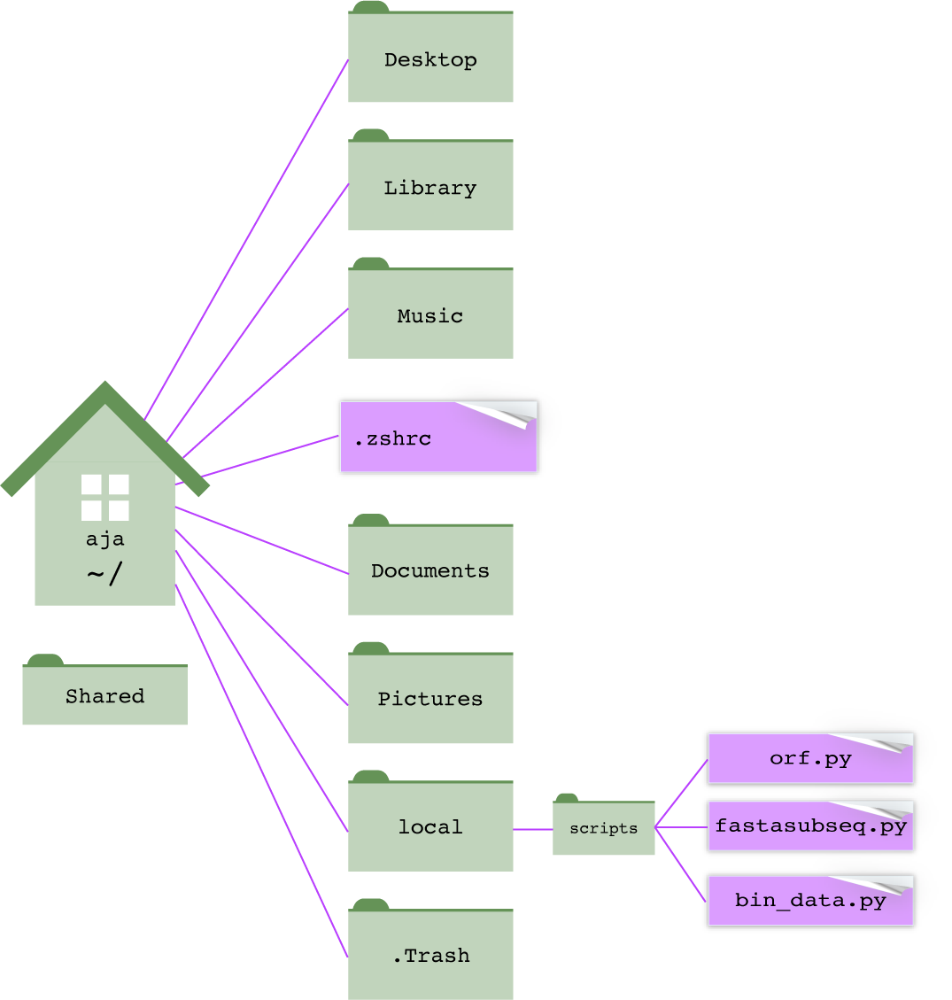

# Tailoring your shell {#shell-config}

::: {.goals}
**In this chapter**

- where the programs you run actually live, and how the shell finds them (your
  `$PATH`)
- how to make your own scripts runnable from anywhere
- the shell's configuration files (`.zshrc`, `.bashrc`, and `.bash_profile`),
  and which one to use
- how to make aliases (keyboard shortcuts) for commands you use a lot
- how to add color, a longer history, and a safety net against overwriting
  files
:::

## Where are executable programs installed? {#path}

When you type `ls`, the shell runs a program called `ls`. That program is a
file, sitting in a directory somewhere on your computer. So where is it, and
how did the shell know where to look?

### `which` and `type`

`which` tells you where a command lives on the file system:

```{bash}
which ls
which less
which python3
```

So `ls` is the file `/bin/ls`. You could run it by typing its full path, and
it would do exactly the same thing:

```{bash, eval = FALSE}
/bin/ls
```

Now try `which cd`. In Zsh, you'll get `cd: shell built-in command`. That's
because `cd` isn't a program at all: it's built into the shell itself (Section \@ref(shell)). `type` tells
you what kind of command something is, whether it's a builtin, a program, or
an alias (Section \@ref(aliases)):

```{bash}
type cd
type ls
```

### The `$PATH` variable

The shell finds programs using a variable called `PATH`, a list of
directories separated by colons:

```{bash, eval = FALSE}
echo $PATH
```

```text
/opt/homebrew/bin:/usr/local/bin:/usr/bin:/bin:/usr/sbin:/sbin
```

Yours will look different. Colons are hard to read, so here's a trick to print
one directory per line. This is the `PATH` on the computer that built this
book:

```{bash}
echo $PATH | tr ':' '\n'
```

When you type a command, the shell:

1. checks whether it's an **alias**, a shortcut name you've defined for a
   longer command (Section \@ref(aliases)), or a **builtin**, a command built
   into the shell itself, like `cd` (see `type`, above);
2. if it's neither, looks in each directory in your `PATH`, **in order**, for
   a program with that name;
3. runs the **first** one it finds.

If it doesn't find the program in any of those directories, you get the
dreaded message:

```text
zsh: command not found: blastn
```

This means "I looked in every directory in your `PATH`, and no program has
that name." Either the program isn't installed, or it is installed but in a
directory that isn't in your `PATH`.

### Order matters

You can have several programs with the same name in different directories.
`which -a` lists all of them, in the order the shell searches:

```{bash}
which -a python3
```

This computer has three different `python3` programs: one from conda, one from
Homebrew, and one from Apple. Typing `python3` runs the first one, the conda
version, because `/opt/miniconda3/bin` comes first in the `PATH`. This is
the source of many "but it works on my computer!" mysteries. When a program
behaves unexpectedly, `which` is one of the first things to check.

::: {.note}
**Package managers edit your `PATH`.** When you install conda or Homebrew,
the installer adds lines to your shell's configuration file (Section
\@ref(config-files)) that put its directories at the front of your `PATH`.
That's how conda's `python3` wins in the example above.
:::

### Why `./script.sh`?

This also explains why you have to type `./` to run your own script (Section
\@ref(bash-scripts)). The current directory (`.`) isn't in your `PATH`, so
the shell won't look there unless you give it the path to the script
explicitly. (Leaving `.` out of the `PATH` is deliberate. It keeps a
malicious program named, say, `ls` in some directory you `cd` into from
running when you type `ls`.)

### Changing the `PATH` {#change-path}

`PATH` is a variable, so you can change it like any other variable (Section
\@ref(variables)). To **add** a directory, include the current value,
`$PATH`, plus the new directory, separated by a colon:

```{bash, eval = FALSE}
export PATH="$PATH:$HOME/local/scripts"    # add to the end: searched last
export PATH="$HOME/local/scripts:$PATH"    # add to the front: searched first
```

`export` makes the variable available to programs that the shell runs, not
just to the shell itself. `PATH` needs it.

Adding to the end is the safer choice: your directory is searched last, so
nothing in it can accidentally replace a standard command. Add to the front
only when you specifically want your version of a program to win.

::: {.warning}
**Don't forget the `$PATH`.** What's the difference between these two lines?

```{bash, eval = FALSE}
export PATH="$PATH:$HOME/local/scripts"
export PATH="$HOME/local/scripts"
```

The first *adds* a directory to your `PATH`. The second *replaces* your
entire `PATH` with a single directory, and suddenly nothing works:

```{bash}
PATH=/nowhere
ls
echo "The shell can't find ls anymore."
```

If this happens, don't panic. A change typed at the command line only lasts
until you close the Terminal window, so just open a new one. If the bad line
is in a configuration file, open a new window anyway and fix the file by
calling the editor by its full path (for example, `/usr/bin/nano ~/.zshrc`).
:::

A `PATH` change typed at the command line lasts only for the current Terminal
window. To make it permanent, put the `export` line in your shell's
configuration file, which runs every time you open a new window. That's the
subject of the rest of this chapter.

### A home for your own scripts {#local-scripts}

As you write more scripts, you'll want to run them from anywhere, just like
`ls` or `grep`, without typing `./` or a long path. The standard way to do
that:

1. Make a directory for your scripts, such as `~/local/scripts`.
2. Add that directory to your `PATH`, permanently.
3. Put each script there, with a shebang line (Section \@ref(bash-scripts))
   and execute permission (`chmod u+x`).

```{r local-scripts, echo = FALSE, out.width = "60%", fig.cap = "Keep your own scripts in one directory, like `~/local/scripts`, and add that directory to your `PATH`. Then you can run `orf.py` from any directory, just by typing its name."}

```

A common arrangement, borrowed from how Unix organizes its own files:

| Directory          | What goes there                                                 |
|--------------------|-----------------------------------------------------------------|
| `~/local/scripts`  | scripts you write yourself (Python, Bash, ...)                  |
| `~/local/src`      | source code and downloaded software                             |
| `~/local/bin`      | executable programs you've installed or compiled yourself       |

Add both `~/local/scripts` and `~/local/bin` to your `PATH`, and anything you
put in them is always available.

::: {.exercise}
1. Use `which` to find where `grep`, `sort`, `nano`, and `python3` are
   installed. Use `type` on `echo`, `pwd`, and `cd`. Which are builtins?
2. Print your `PATH`, one directory per line. How many directories does the
   shell search? Which is searched first?
3. How many `python3` programs are on your computer? Which one runs when you
   type `python3`?
4. In a new Terminal window, run `PATH=/nowhere`, then try `ls`, `pwd`, and
   `/bin/ls`. Explain what works, what doesn't, and why. Then close the
   window.
:::

## The shell's configuration files {#config-files}

Every time you open a Terminal window, the shell runs a configuration file
(sometimes called a startup file or "dotfile") from your home directory.
Anything in that file, such as `PATH` changes, aliases, colors, and other
settings, is applied before you see your first prompt. There's virtually no
limit to what you can set there.

These files start with a `.`, so they're hidden. Use `ls -a` to see them:

```{bash, eval = FALSE}
ls -a ~
```

### Which file? It depends on your shell

First, find out which shell you're using:

```{bash, eval = FALSE}
echo $SHELL
```

On a Mac, it's almost certainly `/bin/zsh`, the default since 2019. On Linux,
including the computing cluster, it's usually `/bin/bash`. Each shell reads
different files:

| File              | Shell | When it runs                                                          |
|-------------------|-------|-----------------------------------------------------------------------|
| `~/.zshrc`        | Zsh   | every interactive shell: every new Terminal window or tab            |
| `~/.zprofile`     | Zsh   | login shells only, before `.zshrc`                                     |
| `~/.zshenv`       | Zsh   | *every* Zsh, even ones that run scripts                               |
| `~/.bash_profile` | Bash  | **login** shells: logging in with `ssh`, and every window in Mac Terminal |
| `~/.bashrc`       | Bash  | **non-login** interactive shells: new windows in most Linux terminals, or typing `bash` |

### Zsh: use `~/.zshrc`

If you use Zsh (most Mac users), put your settings in **`~/.zshrc`**. It runs
for every new Terminal window and tab, and it's where you'll find advice
online telling you to put things.

::: {.note}
**What about `.zshenv`?** Some guides, and earlier versions of this course,
put `PATH` changes in `~/.zshenv`. That works too, but on macOS a system file
that runs after `.zshenv` (`/etc/zprofile`) can reorder your `PATH`, moving
your directories behind the system's. Setting `PATH` in `~/.zshrc` avoids
that surprise.
:::

### Bash: `.bash_profile` vs. `.bashrc`

Bash is more confusing, because it reads different files depending on whether
the shell is a **login shell**:

- A **login shell** is the first shell you get when you log in: when you `ssh`
  into the cluster, for example. Bash runs `~/.bash_profile`.
- A **non-login shell** is any other interactive shell: a new window in most
  Linux terminal programs, or a shell started by typing `bash`. Bash runs
  `~/.bashrc`.
- To add to the confusion, the Mac Terminal app treats every new window as a
  login shell, so Bash on a Mac reads `~/.bash_profile`.

The usual solution is to put all your settings in `~/.bashrc`, and have
`~/.bash_profile` read `~/.bashrc`. Then your settings apply no matter how the
shell starts. Make sure your `~/.bash_profile` contains these lines (on most
Linux systems, including the cluster, it already does):

```{bash, eval = FALSE}
# in ~/.bash_profile: also read ~/.bashrc, if it exists
if [ -f ~/.bashrc ]; then
    source ~/.bashrc
fi
```

### In short

| You're using...                       | Put your settings in...                                        |
|---------------------------------------|----------------------------------------------------------------|
| Zsh (the Mac default)                 | `~/.zshrc`                                                     |
| Bash on the cluster or Linux          | `~/.bashrc` (and check that `~/.bash_profile` reads it)        |
| Bash on a Mac                         | `~/.bash_profile`, or `~/.bashrc` read by `~/.bash_profile`    |

### Editing your configuration file

Your configuration file is an ordinary text file, so edit it with `nano` or
any text editor. Make a backup first: a mistake in this file can make every
new Terminal window misbehave.

```{bash, eval = FALSE}
cp ~/.zshrc ~/.zshrc.bak   # back it up (skip this if the file doesn't exist yet)
nano ~/.zshrc              # edit it; nano creates it if it doesn't exist
```

Changes take effect in **new** Terminal windows. To apply them to the window
you're in, `source` the file, which runs it in your current shell:

```{bash, eval = FALSE}
source ~/.zshrc
```

Lines starting with `#` are comments. To turn a setting off without deleting
it, "comment it out" by putting a `#` at the start of the line.

::: {.warning}
**Don't delete what you didn't write.** Conda, Homebrew, and other installers
add blocks to your configuration file, often marked with comments like `>>>
conda initialize >>>`. Leave those alone, and add your own settings above or
below them.
:::

## Aliases {#aliases}

An **alias** is a shortcut: a short name that the shell replaces with a longer
command. Make one with `alias name='command'`:

```{bash, eval = FALSE}
alias cl='clear'
alias cx='chmod u+x'
alias ll='ls -lh'
alias pin='ssh username@hpc-portal2.hpc.uark.edu'
```

Now typing `cl` clears the screen, `cx myscript.sh` makes a script
executable, `ll` gives a long listing with human-readable sizes, and `pin`
logs you onto the cluster.

- There are **no spaces** around the `=`, just like a variable.
- Put the command in **single quotes**, especially if it contains spaces.
- Anything you type after the alias is added to the end of the command, so
  `cx myscript.sh` becomes `chmod u+x myscript.sh`.

An alias typed at the command line lasts until you close the window. Put it
in your configuration file to keep it.

```{bash, eval = FALSE}
alias              # list all your aliases
type ll            # what does this alias stand for?
unalias ll         # remove an alias (for this session)
```

::: {.tip}
**A safety alias.** Many people add `alias rm='rm -i'`, so `rm` always asks
before deleting. It's a good idea while you're learning. The catch: you can
come to depend on it and then get burned on a computer that doesn't have it.
To skip an alias once, put a backslash in front of the command: `\rm file`.
:::

Aliases work only when you're typing commands interactively; they don't work
inside scripts. For anything more complicated than a shortcut, write a script
and put it in `~/local/scripts` (Section \@ref(local-scripts)).

## Colors

### Colors in `ls` output

Color makes `ls` output much easier to scan: directories, executable programs,
and links stand out from ordinary files. On a Mac, turn colors on and choose
them with two variables in your configuration file:

```{bash, eval = FALSE}
export CLICOLOR=1
export LSCOLORS=cxfxcxdxDxegedabagacad
```

`CLICOLOR=1` turns colors on. `LSCOLORS` chooses them. It's a code of 11
pairs of letters; in each pair, the first letter is the text color and the
second is the background color, for a different kind of file:

| Position | Kind of file          | Above | Meaning                          |
|----------|-----------------------|-------|----------------------------------|
| 1        | directory             | `cx`  | green text, default background   |
| 2        | symbolic link         | `fx`  | magenta                          |
| 3        | socket                | `cx`  | green                            |
| 4        | pipe                  | `dx`  | brown                            |
| 5        | executable            | `Dx`  | bold brown (yellow)              |
| 6–11     | special files you'll rarely see | `egedabagacad` | various |

| Letter | Color   | Letter | Color             |
|--------|---------|--------|-------------------|
| `a`    | black   | `A`    | bold black (gray) |
| `b`    | red     | `B`    | bold red          |
| `c`    | green   | `C`    | bold green        |
| `d`    | brown   | `D`    | bold brown (yellow) |
| `e`    | blue    | `E`    | bold blue         |
| `f`    | magenta | `F`    | bold magenta      |
| `g`    | cyan    | `G`    | bold cyan         |
| `h`    | light gray | `H` | bold light gray (white) |
| `x`    | default |        |                   |

So to make directories bold blue instead of green, change the first pair
from `cx` to `Ex`.

::: {.note}
**Colors on Linux.** The GNU `ls` on Linux uses a different system: colors
are turned on with `ls --color=auto` (usually already set up as an alias) and
chosen with a variable called `LS_COLORS`, in a different format. On the
cluster, colors are probably on already.

Older guides, including earlier versions of this course, also set
`export TERM=xterm-color`. Modern versions of Terminal don't need it, and it
limits you to 8 colors, so leave it out.
:::

### Terminal colors, fonts, and themes

The Terminal app itself has color themes. Open *Terminal > Settings*
(*Preferences* on older versions of macOS), then the **Profiles** tab. Pick a
theme from the list (Basic, Homebrew, Pro, Ocean, ...), and click
**Default** to use it for every new window. On the same tab, you can change
the font and its size (stick with a monospace font) and the window size.

## History {#history}

The shell remembers the commands you've typed (Section \@ref(getting-around)).
By default, it doesn't remember many. Since your history is a record of what
you did, it's worth keeping a lot more of it, with dates.

**Zsh** (in `~/.zshrc`):

```{bash, eval = FALSE}
HISTSIZE=50000              # commands to remember in the current session
SAVEHIST=50000              # commands to save in the history file
setopt EXTENDED_HISTORY     # save the date and time of each command
```

In Zsh, `history` shows only the last 16 commands. Use `history 1` to see
everything, and `history -i 1` to include dates and times.

**Bash** (in `~/.bashrc`):

```{bash, eval = FALSE}
HISTSIZE=50000                # commands to remember in the current session
HISTFILESIZE=50000            # commands to save in the history file
HISTTIMEFORMAT="%Y-%m-%d "    # show the date of each command in `history`
```

Combine your history with `grep` to find that command you ran last month:

```{bash, eval = FALSE}
history 1 | grep blastn     # Zsh
history | grep blastn       # Bash
```

## A safety net: `noclobber` {#noclobber}

In Section \@ref(data-streams), you saw that `>` overwrites an existing file
without warning. Turn on the `noclobber` option, and the shell refuses to
overwrite files with `>`:

```{bash, eval = FALSE}
set -o noclobber
```

```{bash, sandbox = TRUE}
set -o noclobber
echo "oops" > fruit.txt
echo "fruit.txt was not overwritten"
```

When you really do mean to overwrite a file, use `>|` instead of `>`.
`noclobber` works in both Bash and Zsh. Put it in your configuration file and
it will save you from yourself at least once.

## Customizing your prompt

The prompt can show useful information, such as your user name, the computer
you're on (handy when you have windows open on several computers), and the
directory you're in. Set it with `PROMPT` in Zsh or `PS1` in Bash. Each uses
special codes:

| Shows                         | Zsh (`PROMPT`) | Bash (`PS1`) |
|-------------------------------|----------------|--------------|
| user name                     | `%n`           | `\u`         |
| computer name                 | `%m`           | `\h`         |
| current directory (full)      | `%~`           | `\w`         |
| current directory (last part) | `%1~`          | `\W`         |
| `%`/`#` or `$`/`#` (`#` for administrators) | `%#` | `\$`    |

```{bash, eval = FALSE}
PROMPT='%n@%m %1~ %# '      # Zsh: aja@hostname nt %
PS1='\u@\h \W \$ '          # Bash: aja@hostname nt $
```

## Putting it together {#example-config}

Here's a complete starting configuration file for Zsh on a Mac:

```{bash, eval = FALSE}
# ~/.zshrc

# PATH: my own scripts and programs
export PATH="$PATH:$HOME/local/scripts:$HOME/local/bin"

# colors for ls
export CLICOLOR=1
export LSCOLORS=cxfxcxdxDxegedabagacad

# history: remember a lot, with dates
HISTSIZE=50000
SAVEHIST=50000
setopt EXTENDED_HISTORY

# don't let > overwrite existing files (use >| to force it)
set -o noclobber

# aliases (keyboard shortcuts)
alias cl='clear'
alias cx='chmod u+x'
alias ll='ls -lh'
alias pin='ssh username@hpc-portal2.hpc.uark.edu'
```

And the equivalent for Bash on the cluster, in `~/.bashrc`:

```{bash, eval = FALSE}
# ~/.bashrc

export PATH="$PATH:$HOME/local/scripts:$HOME/local/bin"

HISTSIZE=50000
HISTFILESIZE=50000
HISTTIMEFORMAT="%Y-%m-%d "

set -o noclobber

alias cl='clear'
alias cx='chmod u+x'
alias ll='ls -lh'
```

The course files include a sample configuration file,
`files/other_files/bash_profile.txt`.

::: {.exercise}
1. Which shell are you using? Which configuration files already exist in your
   home directory? (Use `ls -a`.) Look inside them with `less`. Did an
   installer add anything?
2. Back up your configuration file (if you have one), then add the aliases
   `cl`, `cx`, and `ll`. Open a new Terminal window and test them. Use `type`
   to check what `ll` stands for.
3. Turn on colors for `ls`. Then change the code so that directories are bold
   blue.
4. Turn on `noclobber`. Try to overwrite a test file in `/tmp` with `>`. Then
   overwrite it on purpose with `>|`.
5. Increase the size of your history, and use `history` and `grep` to find
   every `cd` command you've run.
6. Choose a Terminal theme and font that you like, and make it the default.
:::

::: {.exercise}
Set up a home for your own scripts:

1. Create `~/local/scripts` and add it to your `PATH` in your configuration
   file. Open a new window and check your `PATH`.
2. Write a short Bash script, `count_seqs.sh`, that counts the sequences in a
   FASTA file given as its first argument. (Inside a script, `$1` is the first
   thing typed after the script's name: `grep -c '>' "$1"`.)
3. Put it in `~/local/scripts`, make it executable, and run it on
   `watermelon_genome/nt/cox1.fasta` from your Desktop, just by typing
   `count_seqs.sh`, with no `./` or path.
4. Use `which count_seqs.sh` to confirm where the shell found it.
:::

::: {.exercise}
On the cluster (Chapter \@ref(remote)):

1. Look at your `~/.bash_profile` and `~/.bashrc`. Does `.bash_profile` read
   `.bashrc`?
2. Add the `ll` alias and the history settings to `~/.bashrc`. Log out, log
   back in, and test them.
3. Add `~/local/scripts` to your `PATH` on the cluster, and copy
   `count_seqs.sh` there. Can you run it from any directory?
:::

## Command summary {#shell-summary}

| Command or file                     | What it does                                         |
|-------------------------------------|------------------------------------------------------|
| `which name`                        | show where a program is installed                    |
| `which -a name`                     | show every program with that name, in search order   |
| `type name`                         | say whether a command is a builtin, program, or alias |
| `echo $PATH`                        | show the directories the shell searches for programs |
| `export PATH="$PATH:dir"`           | add a directory to the end of your `PATH`            |
| `echo $SHELL`                       | show which shell you're using                        |
| `~/.zshrc`                          | Zsh settings, read by every new window               |
| `~/.bashrc`, `~/.bash_profile`      | Bash settings: non-login and login shells            |
| `source file`                       | run a configuration file in the current shell        |
| `alias name='command'`              | make a shortcut                                      |
| `alias`, `unalias name`             | list aliases; remove one                             |
| `CLICOLOR`, `LSCOLORS`              | turn on and choose colors for `ls` (Mac)             |
| `HISTSIZE`, `SAVEHIST`/`HISTFILESIZE` | how much history to keep                           |
| `set -o noclobber`                  | stop `>` from overwriting files (`>\|` to force)     |
| `PROMPT`, `PS1`                     | customize the prompt (Zsh, Bash)                     |
