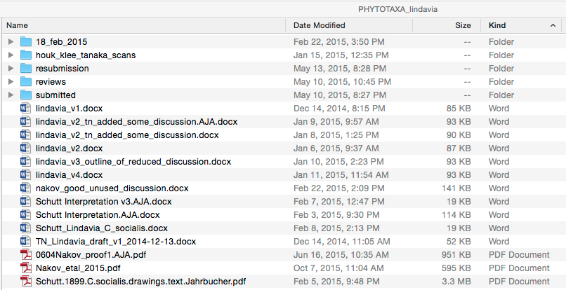
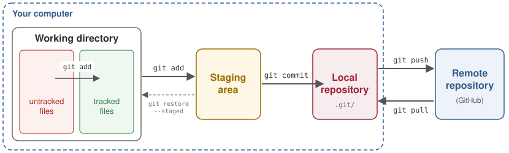
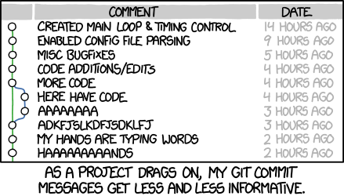
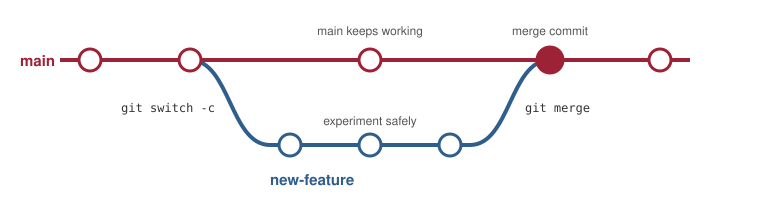
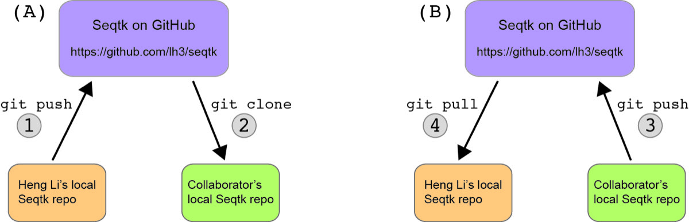

# Version control with Git and GitHub {#git}

::: {.goals}
**In this chapter**

- why scientists should use version control
- how to install and configure Git
- the Git workflow: track, stage, and commit
- how to undo changes, ignore files, and see what changed and when
- how to retrieve an old version of a file
- how to experiment safely with branches, and how to resolve a merge conflict
- how to back up and share your work on GitHub
:::

::: {.note}
**A note about GitHub.** Git and GitHub aren't the same thing. Git is free,
open-source software that runs on your own computer. GitHub is a company that
hosts Git repositories online, and Microsoft has owned it since 2018. Some
people have started moving their projects off GitHub. Concerns include
Microsoft's ownership and the use of code hosted on GitHub to train
Microsoft's AI models, including the Copilot coding assistant, without the
permission of the people who wrote the code. Some are moving to alternatives
such as [Forgejo](https://forgejo.org/), a community-run platform that you can
host yourself or use through services such as [Codeberg](https://codeberg.org/).
Things are changing quickly, and it's not yet clear where the field will
settle. For now, though, GitHub is still the most established and widely used
platform, and it's the one this chapter uses. Everything you learn about Git
itself works the same way on any of them.
:::

## Why version control? {#why-git}

Every project changes over time. At the bench, you keep a lab notebook so you
always have a before-and-after record: the PCR stopped working, so you changed
the annealing temperature; a cheaper kit came out, so you switched. Code needs
the same kind of record:

- a file format changes, so you update your code to read it
- you find a bug, so you fix it
- you add a feature, and something that used to work stops working

Without a system, most of us end up keeping versions by renaming files
(Figure \@ref(fig:versions-by-filename)). This works, sort of, until you can't
remember which file is the latest, what changed between `v2` and
`v3_outline_of_reduced_discussion`, or whose edits are whose. Things get
particularly messy when you collaborate.

```{r versions-by-filename, echo = FALSE, out.width = "85%", fig.cap = "Version control by file name. One manuscript, many versions, two collaborators."}

```

A **version control system** solves this problem properly. **Git**, written
by Linus Torvalds (who also wrote Linux) to manage thousands of programmers
working on Linux at the same time, is by far the most popular one. Git lets
you:

- keep **snapshots** of your project, so you can trace the origin of a bug and
  roll back a bad change
- trace how your code evolved, and why, which helps make your work
  **reproducible**
- keep your code organized and available after people leave the lab
- **share** your code with others and work on it together

Git is the standard tool for version control in data science and
bioinformatics. Nearly every bioinformatics program you'll download comes from
a Git repository.

::: {.note}
**Further reading.** This chapter follows the Git chapter of Vince Buffalo's
[*Bioinformatics Data Skills*](#references) (O'Reilly, 2015). For a complete
reference, see the free book [*Pro Git*](https://git-scm.com/book/en/v2).
Both are listed in the [References](#references).
:::

## Installing and configuring Git {#git-setup}

Check whether Git is already installed:

```{bash, eval = FALSE}
git --version
```

If it isn't, here's how to install it
([more details](https://git-scm.com/book/en/v2/Getting-Started-Installing-Git)):

| System  | How to install Git                                                          |
|---------|-----------------------------------------------------------------------------|
| Mac     | Run `xcode-select --install` (Apple's command-line tools include Git), or `brew install git` |
| Linux / WSL | `sudo apt install git` (Ubuntu and Debian)                              |

Git commands all take the form `git <subcommand>`. Before you use Git, tell it
who you are. Git records your name and email address with every change you
make. You only need to do this once per computer:

```{bash, eval = FALSE}
git config --global user.name "Your Name"
git config --global user.email "you@uark.edu"
git config --global init.defaultBranch main   # name the first branch "main"
git config --global core.editor nano          # the editor Git opens for messages
git config --global color.ui true             # color-coded output
git config --list                             # check your settings
```

`--global` stores these settings in the file `~/.gitconfig`, so they apply to
every project on that computer. Use the same email address you use (or will
use) for GitHub.

::: {.note}
**Why `init.defaultBranch`?** Every repository starts on a default branch
(Section \@ref(branches)). Git originally called it `master`; GitHub and most
projects now call it `main`. Without this setting, Git still uses `master` and
prints a hint every time you create a repository. You'll see both names in
tutorials. They mean the same thing.
:::

## Creating a repository {#git-init}

A **repository** (or **repo**) is a project directory whose history Git is
keeping track of. Let's make one called `bio_project`, then turn it into a Git
repository with `git init`:

```{bash, eval = FALSE}
mkdir bio_project
cd bio_project
git init
```

```{bash, sandbox = TRUE, echo = FALSE, results = "hide"}
mkdir bio_project
cd bio_project
git init
```

```
Initialized empty Git repository in /Users/you/bio_project/.git/
```

`git init` creates a hidden directory, `.git`, where Git stores the entire
history of your project:

```{bash, sandbox = TRUE, dir = "bio_project"}
ls -a
```

You never need to touch anything inside `.git`. But don't delete it: that
would delete your project's history.

::: {.warning}
**Don't make a repository inside another repository.** Run `git init` once,
at the top level of a project. If `git status` (below) works in a directory
where you haven't run `git init`, you're already inside a repository.
:::

## Track, stage, commit {#git-workflow}

Figure \@ref(fig:git-workflow) shows how Git works. Files in your project
directory (the **working directory**) are either **untracked** (Git ignores
them) or **tracked** (Git is watching them). When you've made changes worth
keeping, you `git add` them to the **staging area**, and then `git commit`
stores a permanent snapshot of everything that's staged in your **local
repository**. Later in the chapter, you'll `git push` your commits to a
**remote repository** on GitHub.

```{r git-workflow, echo = FALSE, out.width = "100%", fig.cap = "The Git workflow. `git add` starts tracking a file and stages its changes; `git commit` stores the staged changes in the repository; `git push` and `git pull` send and receive commits from a remote repository."}

```

### Checking the status of your files {#git-status}

Let's add some files to `bio_project`. The `touch` command creates empty files:

```{bash, sandbox = TRUE, dir = "bio_project"}
mkdir data
touch README data/README data/sample1.fasta data/sample2.fasta
git status
```

`git status` is the command you'll use most. It tells you which branch you're
on (`main`, the default), what's happened since your last commit, and often
what to do next. Right now Git sees some new files and a new directory, but
it isn't tracking any of them.

### Tracking files with `git add` {#git-add}

`git add` tells Git to start tracking files:

```{bash, sandbox = TRUE, dir = "bio_project"}
git add README data/README
git status
```

The two README files are now tracked, and their current versions are
**staged**: they'll be included in the next commit. The FASTA files are still
untracked.

### Staging changes with `git add` {#git-stage}

Now let's change `README`:

```{bash, sandbox = TRUE, dir = "bio_project"}
echo "The README file for my project" >> README
git status
```

`README` now appears twice: once under *Changes to be committed* and once
under *Changes not staged for commit*. That's because Git staged a snapshot
of `README` when we ran `git add`, *before* we added that line. If we commit
now, the commit will hold the empty `README`, not the new version.

To include the new line, stage `README` again:

```{bash, sandbox = TRUE, dir = "bio_project"}
git add README
git status
```

So `git add` does two things:

1. starts tracking a file that Git isn't tracking yet
2. stages the current changes to a file that Git is already tracking

::: {.warning}
**Changes are staged as they were when you ran `git add`.** Anything you
change after `git add` isn't included in the next commit unless you
`git add` the file again. `git status` tells you when that's the case.
:::

### Storing changes with `git commit` {#git-commit}

`git commit` stores a snapshot of everything that's staged, along with a
message that describes the change:

```{bash, sandbox = TRUE, dir = "bio_project"}
git commit -m "Initial import"
git status
```

That's it: the two README files are safely stored in the repository. The
seven characters after `main` (and `root-commit`, meaning this is the first
commit) are the start of the commit's ID. Git computes a unique ID for every
commit from its contents (a SHA-1 checksum, like the ones in Section
\@ref(checksums)). Your IDs will differ from the ones in this book.

If you leave off `-m "message"`, Git opens your editor so you can write the
message there. Save and exit, and Git makes the commit.

::: {.note}
**Why have a staging area at all?** You'll often be working on several files
at once. Some changes will be finished, others not. Staging lets you choose
exactly which changes go into each commit, so each commit is a meaningful step
in your project ("Fix the GC-content calculation") rather than a random
snapshot of everything you happened to be working on.
:::

#### Writing good commit messages {-}

Your commit messages are the history of your project. Six months from now,
"Fix off-by-one error in exon coordinates" will mean something; "stuff" will
not (Figure \@ref(fig:xkcd-commit)).

```{r xkcd-commit, echo = FALSE, out.width = "70%", fig.cap = "Commit messages over the life of a project. [xkcd.com/1296](https://xkcd.com/1296/), CC BY-NC 2.5."}

```

- Write a short summary, about 50 characters or less, that says what the
  commit does: "Add GC-content function", "Fix crash on empty FASTA files".
- Commit often, in small, related chunks. One commit, one idea.
- Don't commit broken code to `main` if you can help it. That's what branches
  are for (Section \@ref(branches)).

## Undoing changes {#git-restore}

Let's add a line to `README` and stage it:

```{bash, sandbox = TRUE, dir = "bio_project"}
echo "Wrote the best script of my life" >> README
git add README
git status
```

Changed your mind? Git tells you how to **unstage** the file with
`git restore --staged`:

```{bash, sandbox = TRUE, dir = "bio_project"}
git restore --staged README
git status
```

The change is no longer staged, but it's still in the file. To throw the
change away entirely and put the file back the way it was at the last commit,
use `git restore` without `--staged`:

```{bash, sandbox = TRUE, dir = "bio_project"}
git restore README
cat README
git status
```

::: {.warning}
**`git restore file` can't be undone.** It overwrites your file with the
version from the last commit. Any changes you hadn't committed are gone for
good, just as with `rm`.
:::

::: {.note}
**`git checkout` and `git reset`.** `git restore` (and `git switch`, below)
arrived in 2019. Older tutorials, and Stack Overflow, do the same things with
`git checkout -- file` (discard changes) and `git reset HEAD file` (unstage).
Both still work.
:::

## Ignoring files with `.gitignore` {#gitignore}

`git status` keeps reminding us that the FASTA files aren't being tracked.
Suppose we don't want them in the repository: they're large and can be
downloaded again. List the files Git should ignore, one pattern per line, in
a file called `.gitignore` at the top of the repository:

```{bash, sandbox = TRUE, dir = "bio_project"}
echo 'data/*.fasta' > .gitignore
git status
```

The FASTA files have disappeared from the list. `.gitignore` itself is a file
worth keeping, so commit it:

```{bash, sandbox = TRUE, dir = "bio_project"}
git add .gitignore
git commit -m "Ignore FASTA files in data/"
git status
```

*Working tree clean* means everything in the directory is either committed or
ignored. Here's a typical `.gitignore` for a bioinformatics project:

```text
# large data and results: keep these out of the repository
data/
results/
*.fastq.gz
*.bam

# junk your computer makes
.DS_Store
__pycache__/
.Rproj.user/
.Rhistory
```

::: {.warning}
**Keep big data files out of Git.** Git is built for text files such as code,
notes, and small tables. It keeps every version of every file forever, so
large data files bloat your repository. GitHub won't accept files larger than
100 MB. Back up data separately, and keep the commands that download or
generate it (Section \@ref(download)) in the repository instead.
:::

## Viewing history with `git log` {#git-log}

Let's make one more commit:

```{bash, sandbox = TRUE, dir = "bio_project"}
echo "Project started 2026-01-14" >> README
git add README
git commit -m "Add project start date"
```

`git log` lists the commits, newest first:

```{bash, sandbox = TRUE, dir = "bio_project"}
git log
```

Each commit has a full 40-character ID, an author, a date, and the commit
message. A few useful options:

```{bash, sandbox = TRUE, dir = "bio_project"}
git log --oneline
```

```{bash, sandbox = TRUE, dir = "bio_project"}
git log --name-status -n 2
```

`--oneline` gives one short line per commit, `--name-status` lists the files
each commit changed (`A` added, `M` modified, `D` deleted, `R` renamed), and
`-n 2` shows only the two most recent commits.

## Seeing what changed with `git diff` {#git-diff}

`git diff` shows exactly what you've changed. Add a line to `README`:

```{bash, sandbox = TRUE, dir = "bio_project"}
echo "Samples collected from Lake Fayetteville" >> README
git diff
```

The format is similar to `diff -u` (Section \@ref(diff)):

- `--- a/README` is the old version and `+++ b/README` is the new one.
- `@@ -1,2 +1,3 @@` says which lines are shown: lines 1–2 of the old version
  and lines 1–3 of the new one.
- Lines that start with `+` were added, lines that start with `-` were
  deleted, and lines that start with a space are unchanged context. A line
  that you edited shows up as a deleted line followed by an added line.

By default, `git diff` compares your working directory to the staging area,
which shows changes you **haven't staged yet**. What happens after
`git add`?

```{bash, sandbox = TRUE, dir = "bio_project"}
git add README
git diff
```

Nothing, because there are no unstaged changes left. To see what's staged and
about to be committed, use `git diff --staged`:

```{bash, sandbox = TRUE, dir = "bio_project"}
git diff --staged
git commit -m "Add sampling location"
```

## Renaming and deleting files {#git-mv}

If you rename or delete a tracked file with `mv` or `rm`, Git sees the old file
as deleted and the new file as untracked. Do it Git's way instead, with
`git mv` and `git rm`, which make the change and stage it in one step. Let's
give the README files a `.md` extension, which tells GitHub that they're
written in Markdown (Section \@ref(github-readme)):

```{bash, sandbox = TRUE, dir = "bio_project"}
git mv README README.md
git mv data/README data/README.md
git status
```

```{bash, sandbox = TRUE, dir = "bio_project"}
git commit -m "Add Markdown extension to README files"
```

`git rm file` deletes a file and stages the deletion. `git rm --cached file`
stops tracking a file but leaves it on your computer, which is handy when you
committed a file by mistake and want to add it to `.gitignore`.

## Retrieving an old version {#git-old-versions}

This is where version control earns its keep. Let's make a change we'll come
to regret:

```{bash, sandbox = TRUE, dir = "bio_project"}
echo "TODO: delete all the raw data" >> README.md
git commit -am "Update README"
git log --oneline
```

`git commit -a` stages every change to tracked files before committing, so
you can skip `git add`. It never adds untracked files. Use it only when you
know what you've changed.

To view an old version of a file without changing anything, use
`git show commit:file`. Instead of a commit ID, you can count back from the
most recent commit, which Git calls `HEAD`: `HEAD~1` is one commit before,
`HEAD~2` is two before, and so on.

```{bash, sandbox = TRUE, dir = "bio_project"}
git show HEAD~1:README.md
```

To get that version back, restore the file from that commit:

```{bash, sandbox = TRUE, dir = "bio_project"}
git restore --source=HEAD~1 README.md
cat README.md
git status
```

The old version is now in your working directory, as a change you can commit:

```{bash, sandbox = TRUE, dir = "bio_project"}
git commit -am "Remove bad advice from README"
```

The bad version is still in the history, in case you ever want it back. That's
the point: once you've committed something, it's very hard to lose. You can
use a commit ID in place of `HEAD~1`, for example
`git restore --source=4f2a9c1 README.md`. The first seven characters are
plenty.

::: {.exercise #ex-git-local}
Turn the project you organized in Exercise \@ref(exr:ex-project) into a Git
repository (or make a new one; just not inside `bio_project`).

1. Commit your `README.md`, `notebook.Rmd`, and scripts. (If you made a new
   project, add a `README.md` with a sentence about it and a script or two
   from Chapter \@ref(unix) or \@ref(shell-config) first.)
2. Edit one of the files. Use `git diff` to see what you changed. Stage the
   change and run `git diff` again, then `git diff --staged`. Commit.
3. Make a change to a file, stage it, and then unstage it. Then discard the
   change entirely. Check with `git status` after each step.
4. Create a `.gitignore` that ignores a `data/` directory. Make the directory,
   put a file in it, and check that `git status` doesn't list it.
5. Run `git log --oneline`. Use `git show` to view the first version of your
   `README.md`.
:::

## Branches {#branches}

A **branch** is an independent line of development. Branches let you try
something new (a major new feature, a different way of doing an analysis)
without any risk of breaking the version on `main` that works. If the
experiment works out, you **merge** it back into `main`. If it doesn't, you
abandon the branch and `main` is unscathed. Collaborators can each work on
their own branch and merge their work in when it's ready.

```{r branches, echo = FALSE, out.width = "100%", fig.cap = "Working on a branch. You create a branch from main and make commits on it, while main carries on. When the work is done, you merge it back into main."}

```

Branches are cheap: Git doesn't copy your files to make one, so creating and
switching branches is instant.

### Creating, switching, and merging {#git-switch}

`git branch` lists the branches, with a `*` next to the one you're on. Let's
make a new branch called `readme-changes` and switch to it:

```{bash, sandbox = TRUE, dir = "bio_project"}
git branch readme-changes
git branch
git switch readme-changes
git branch
```

Now make a change and commit it on `readme-changes`:

```{bash, sandbox = TRUE, dir = "bio_project"}
echo "Data are in data/, one FASTA file per sample." >> README.md
git commit -am "Describe the data directory"
git log --oneline -n 3
```

The new commit exists only on `readme-changes`. If you switch back to `main`,
the new line disappears from `README.md`:

```{bash, sandbox = TRUE, dir = "bio_project"}
git switch main
tail -n 2 README.md
```

It's not gone. It's on the other branch. To bring it into `main`, switch to
the branch you want to merge *into* (`main`, which we just did) and then merge
the other branch:

```{bash, sandbox = TRUE, dir = "bio_project"}
git merge readme-changes
tail -n 2 README.md
```

Because `main` hadn't changed since we created the branch, Git simply moved
`main` forward to include the new commit, a **fast-forward** merge. If both
branches have new commits, Git combines them in a new **merge commit**, as in
Figure \@ref(fig:branches).

Once a branch is merged, you can delete it:

```{bash, sandbox = TRUE, dir = "bio_project"}
git branch -d readme-changes
```

::: {.tip}
**Create and switch in one step.** `git switch -c new-branch` creates a branch
and switches to it. (In older tutorials: `git checkout -b new-branch`.)
:::

### Merge conflicts {#merge-conflicts}

Git can merge changes to different files, or to different parts of the same
file, on its own. But if two branches change *the same lines* of a file, Git
can't know which version you want. That's a **merge conflict**, and you have
to resolve it yourself. Conflicts sound scary, but they're routine.

Let's make one. On a new branch, change the first line of `README.md` and
commit:

```{bash, eval = FALSE}
git switch -c new-title
nano README.md            # change the first line
```

```{bash, sandbox = TRUE, dir = "bio_project", echo = FALSE, results = "hide"}
git switch -c new-title
sed -i.bak '1s/.*/# bio_project/' README.md && rm README.md.bak
```

```{bash, sandbox = TRUE, dir = "bio_project"}
git diff
git commit -am "Shorter title"
```

Meanwhile, back on `main`, we change the same line differently:

```{bash, eval = FALSE}
git switch main
nano README.md            # change the first line
```

```{bash, sandbox = TRUE, dir = "bio_project", echo = FALSE, results = "hide"}
git switch main
sed -i.bak '1s/.*/# Diatom genomics project/' README.md && rm README.md.bak
```

```{bash, sandbox = TRUE, dir = "bio_project"}
git diff
git commit -am "Better title"
```

Now merge `new-title` into `main`:

```{bash, sandbox = TRUE, dir = "bio_project", error = TRUE}
git merge new-title
```

Git merged what it could and stopped at the conflict. `git status` lists the
files that need attention:

```{bash, sandbox = TRUE, dir = "bio_project"}
git status
```

Git marked the conflict inside the file:

```{bash, sandbox = TRUE, dir = "bio_project"}
cat README.md
```

The lines between `<<<<<<< HEAD` and `=======` are the version on the branch
you're on (`main`). The lines between `=======` and `>>>>>>> new-title` are
the version from the other branch. To resolve the conflict:

1. Open the file in your editor.
2. Edit it so it says what you want. That might be one version, the other, or
   a combination.
3. Delete the three marker lines (`<<<<<<<`, `=======`, `>>>>>>>`).
4. Stage the file with `git add` and commit.

```{bash, eval = FALSE}
nano README.md            # fix the conflict and delete the markers
```

```{bash, sandbox = TRUE, dir = "bio_project", echo = FALSE, results = "hide"}
sed -i.bak -e '/^<<<<<<< /d' -e '/^=======/,/^>>>>>>> /d' README.md && rm README.md.bak
```

```{bash, sandbox = TRUE, dir = "bio_project"}
head -n 1 README.md
git add README.md
git commit -m "Merge new-title, keeping the longer title"
git log --oneline --graph
```

`git log --graph` draws the history of the branches and the merge commit that
joins them, just like Figure \@ref(fig:branches).

::: {.tip}
**Changed your mind?** In the middle of a conflicted merge, `git merge --abort`
puts everything back the way it was before you ran `git merge`.
:::

::: {.exercise}
In your own repository:

1. Create a branch, switch to it, and commit a change to a file. Switch back
   to `main` and confirm that the change isn't there. Merge the branch into
   `main`, and delete the branch.
2. Create a merge conflict on purpose: make two branches that change the same
   line of the same file differently, and merge one into the other. Resolve the
   conflict, and look at the result with `git log --oneline --graph`.
:::

## Remote repositories and GitHub {#github}

So far, everything has lived in a single repository on your own computer. A
**remote repository** is a copy of your repository hosted somewhere else,
usually on a service such as [GitHub](https://github.com) (others include
GitLab and Bitbucket). A remote repository:

- **backs up** your work: if your laptop dies, your code and its entire
  history are safe
- **shares** your work: anyone can see your public repositories (this course's
  materials are on GitHub)
- lets you **collaborate**: everyone works in their own local repository and
  exchanges commits through the shared remote

Git is a **distributed** version control system: every copy of a repository
contains the full history of the project, and every collaborator can work,
commit, and look through the history without a network connection. You only
need the network to exchange commits:

- `git push` sends your new commits to the remote.
- `git pull` fetches new commits from the remote and merges them into your
  local repository.
- `git clone` copies a remote repository, and its entire history, to your
  computer.

Figure \@ref(fig:collaboration) shows how this works for
[`seqtk`](https://github.com/lh3/seqtk), a popular toolkit for working with
FASTA and FASTQ files. Its author, Heng Li, pushes his changes to GitHub,
where a collaborator clones the repository (A). When the collaborator pushes a
change, Heng Li can pull it into his own copy (B). The history on GitHub is a
mix of commits from Heng Li and everyone else who contributes.

```{r collaboration, echo = FALSE, out.width = "100%", fig.cap = "Collaborating through a shared repository on GitHub."}

```

### Cloning a repository {#git-clone}

To get a copy of any public repository, find the green **Code** button on its
GitHub page, copy the URL, and use `git clone`:

```{bash, eval = FALSE}
git clone https://github.com/lh3/seqtk.git
```

```
Cloning into 'seqtk'...
remote: Enumerating objects: 409, done.
remote: Counting objects: 100% (33/33), done.
remote: Compressing objects: 100% (18/18), done.
remote: Total 409 (delta 18), reused 16 (delta 15), pack-reused 376 (from 3)
Receiving objects: 100% (409/409), 202.57 KiB | 901.00 KiB/s, done.
Resolving deltas: 100% (232/232), done.
```

This creates a directory called `seqtk` that's a complete Git repository,
`.git` directory and all. You can run `git log` to see its whole history. Many
bioinformatics programs are installed this way: clone the repository, then
build the program by following its README. To get the author's latest changes
later, run `git pull` inside the directory.

### Setting up GitHub {#github-setup}

1. **Create an account** at [github.com](https://github.com). Pick a
   professional username: it will appear in the URL of everything you share.
   Students can also apply for the free
   [GitHub Education](https://education.github.com/) benefits.
2. **Set up authentication.** GitHub doesn't accept your account password
   when you push from the command line. Use one of these instead.

**Option 1: SSH keys (recommended).** If you made an SSH key in Section
\@ref(ssh-keys), you can use the same key for GitHub. Print your *public* key
and copy it:

```{bash, eval = FALSE}
cat ~/.ssh/id_ed25519.pub
```

On GitHub, go to *Settings > SSH and GPG keys > New SSH key*, paste it in,
and save. Then test the connection:

```{bash, eval = FALSE}
ssh -T git@github.com
```

```
Hi yourname! You've successfully authenticated, but GitHub does not provide shell access.
```

With SSH, use the repository's SSH URL, which looks like
`git@github.com:yourname/bio_project.git`.

**Option 2: HTTPS with a personal access token.** A token is a long, random
password that you create on GitHub, at *Settings > Developer settings >
Personal access tokens*
([instructions](https://docs.github.com/en/authentication/keeping-your-account-and-data-secure/managing-your-personal-access-tokens)).
Give it an expiration date and only the access it needs (for a fine-grained
token, *Contents: Read and write* on your repositories). Copy the token right
away: GitHub shows it only once. When Git asks for your password, paste the
token. On a Mac, Git saves it in your Keychain so you don't have to paste it
every time. With HTTPS, use URLs like
`https://github.com/yourname/bio_project.git`.

::: {.warning}
**Treat a token like a password.** Anyone with your token can do whatever the
token allows to your GitHub account. Don't put it in a script, email it, or
commit it to a repository. If one leaks, delete it on GitHub and make a new
one.
:::

::: {.tip}
**Working on the cluster?** Git works the same way on the cluster. To push from
there, make an SSH key *on the cluster* with `ssh-keygen` and add that public
key to GitHub too. You can add as many keys as you like, one per computer.
:::

### Pushing a local repository to GitHub {#git-push}

To put `bio_project` on GitHub:

1. On GitHub, click **+** (top right) > **New repository**.
2. Name it `bio_project`. Choose public or private.
3. **Don't** add a README, `.gitignore`, or license. We already have a
   repository with its own history, so the one on GitHub should start out
   empty.
4. Click **Create repository**. GitHub shows the commands you need, with your
   repository's URL filled in.

Back in the Terminal, inside `bio_project`, tell your local repository about
the remote. By convention, the main remote is named `origin`:

```{bash, eval = FALSE}
git remote add origin git@github.com:yourname/bio_project.git
git remote -v             # check it
```

```
origin  git@github.com:yourname/bio_project.git (fetch)
origin  git@github.com:yourname/bio_project.git (push)
```

Then push. The first time, `-u origin main` links your local `main` branch to
`main` on GitHub, so later you can simply type `git push` and `git pull`:

```{bash, eval = FALSE}
git push -u origin main
```

```
Enumerating objects: 26, done.
Counting objects: 100% (26/26), done.
Delta compression using up to 8 threads
Compressing objects: 100% (16/16), done.
Writing objects: 100% (26/26), 2.31 KiB | 2.31 MiB/s, done.
Total 26 (delta 5), reused 0 (delta 0), pack-reused 0 (from 0)
To github.com:yourname/bio_project.git
 * [new branch]      main -> main
branch 'main' set up to track 'origin/main'.
```

Refresh the repository's page on GitHub: your files, commit messages, and
history are all there.

### The everyday workflow {#git-everyday}

Once a project is on GitHub, a typical working session looks like this:

```{bash, eval = FALSE}
git pull                          # get any changes made elsewhere
# ... work on your files ...
git status                        # what did I change?
git add script.py notes.md        # stage the changes you want to keep
git commit -m "Add GC-content function"
git push                          # back up and share
```

If you work on more than one computer (say, your laptop and the cluster),
always `git pull` before you start and `git push` when you're done. If a
collaborator pushed changes to the same lines you changed, `git pull` reports
a merge conflict, which you resolve exactly as in Section
\@ref(merge-conflicts), and then push.

::: {.note}
**`git push` is rejected?** If GitHub has commits that you don't have yet,
`git push` refuses with a message about the remote containing work that you
don't have locally. Run `git pull` first, resolve any conflicts, and push
again.
:::

### README files and Markdown {#github-readme}

GitHub displays a repository's `README.md` on its front page, so it's the
first thing visitors read. Use it to explain what the project is, how to run
the code, and where the data come from. README files are written in Markdown
(Section \@ref(markdown)). GitHub formats Markdown files wherever they appear in a
repository, so your `data/README.md` (Section \@ref(data-readme)) is nicely
formatted, too.

::: {.exercise}
1. Create a GitHub account if you don't have one, and set up SSH keys or a
   personal access token.
2. Create an empty repository on GitHub and push the repository you made in
   Exercise \@ref(exr:ex-git-local) to it. Look at it on GitHub.
3. Edit `README.md` with some Markdown: a heading, a bulleted list, some
   `code`, and a link. Commit, push, and see how GitHub displays it.
4. On GitHub, edit `README.md` in your browser (the pencil icon) and commit
   the change there. Then run `git pull` on your computer and check that the
   change arrived.
5. Clone the `seqtk` repository. How many commits does it have?
   (Hint: `git log --oneline | wc -l`.)
:::

## Command summary {#git-summary}

| Command                              | What it does                                         |
|--------------------------------------|------------------------------------------------------|
| `git config --global ...`            | set your name, email, and other preferences          |
| `git init`                           | turn the current directory into a repository         |
| `git status`                         | show what's changed, staged, and untracked           |
| `git add file`                       | track a file, or stage its changes                   |
| `git commit -m "message"`            | store the staged changes (`-a` to stage changed tracked files first) |
| `git restore --staged file`          | unstage a file                                       |
| `git restore file`                   | discard changes to a file since the last commit      |
| `git restore --source=HEAD~1 file`   | get a file back from an earlier commit               |
| `git log`                            | list commits (`--oneline`, `--name-status`, `--graph`, `-n 3`) |
| `git diff`                           | show unstaged changes (`--staged` for staged changes) |
| `git show HEAD~1:file`               | print a file as it was in an earlier commit          |
| `git mv`, `git rm`                   | rename or delete a tracked file                      |
| `git branch`                         | list branches (`git branch name` to create one, `-d` to delete) |
| `git switch branch`                  | switch branches (`-c` to create and switch)          |
| `git merge branch`                   | merge another branch into the current one            |
| `git clone url`                      | copy a remote repository to your computer            |
| `git remote add origin url`          | connect a local repository to a remote one           |
| `git push`, `git pull`               | send commits to, or get commits from, the remote     |
