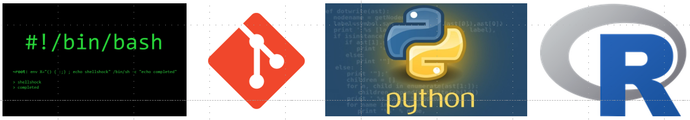

```{r setup, include = FALSE}
# Shell examples in this book are run for real against the course data in
# files/data (the same files students download as files.tgz), so the output
# you see is the output you should get.
#
# Bash chunks start in `data_dir`. Chunk options:
#   dir = "subfolder"  run the chunk from a subfolder of data_dir
#   sandbox = TRUE     run the chunk in a throwaway copy of the course files
#                      (made fresh each build), so it can safely create,
#                      change, or delete files. Sandbox chunks share one copy,
#                      so changes carry forward to later sandbox chunks.
# Chunks that change files must use either `sandbox = TRUE` or `eval = FALSE`.
data_dir <- normalizePath("files/data")

sandbox_dir <- file.path(tempdir(), "sandbox")
unlink(sandbox_dir, recursive = TRUE)
dir.create(sandbox_dir)
file.copy(c(data_dir, normalizePath("files/file_types")), sandbox_dir, recursive = TRUE)

# Git examples run in the sandbox with their own settings, so the output
# doesn't depend on the Git configuration of whoever builds the book.
git_config <- file.path(tempdir(), "gitconfig")
writeLines(c("[user]", "\tname = Andrew Alverson", "\temail = aja@uark.edu",
             "[init]", "\tdefaultBranch = main"), git_config)
Sys.setenv(GIT_CONFIG_GLOBAL = git_config, GIT_CONFIG_NOSYSTEM = "1")

knitr::opts_chunk$set(comment = "", collapse = FALSE, fig.align = "center")

bash_engine <- knitr::knit_engines$get("bash")
knitr::knit_engines$set(bash = function(options) {
  base <- if (isTRUE(options$sandbox)) file.path(sandbox_dir, "data") else data_dir
  old <- setwd(file.path(base, if (is.null(options$dir)) "." else options$dir))
  on.exit(setwd(old))
  # chunks with error = TRUE fail on purpose; don't warn about it
  if (isTRUE(options$error)) suppressWarnings(bash_engine(options)) else bash_engine(options)
})
```

# Welcome {-}

```{r logo, echo = FALSE, out.width = "100%"}

```

This book accompanies **BIOL 51573: Practical Programming for Biologists**.
It introduces the basics of scientific computing for biologists:

- organizing projects and files
- working at the Unix command line
- remote computing on a high-performance computing cluster
- version control with `git` and GitHub
- programming in Python
- automating workflows

Each chapter mirrors what we do in class: **Lecture. Demonstrate. Practice.**
Read the chapter, run the examples yourself, and work through the exercises as
you go. You learn this material by typing it, not by reading it.

## Before the first class {-}

1. Bookmark this book.
2. Enroll in the [DataCamp class](https://www.datacamp.com/groups/shared_links/a84f73bdb85e70197f83520ee390e538c16815a1c5b5453db88a14225cfd1ca2).
3. Register for an [AHPCC user account](https://hpc.uark.edu/hpc-support/user-account-requests/internal.php).
   Your advisor is your sponsor, not the course instructor.
4. Download [`files.tgz`](https://andrewalverson.github.io/practical-programming-for-biologists/files.tgz). This archive holds all the
   example data we use in class (see Section \@ref(course-files)).

## How to read this book {-}

Commands you type at the command line appear in shaded boxes:

```{bash, eval = FALSE}
ls -l
```

When a command produces output, the output follows in a separate white box
marked *output*. Almost all the output in this book was generated by actually
running the command on the course data files, so you should see the same thing
on your own computer (file dates, user names, and a few other details will
differ).

Many Unix tutorials put a `$` at the start of each command to stand for the
*prompt*, the text the shell prints when it is waiting for you to type. This
book leaves the `$` off so you can copy and paste commands directly. Don't type
the `$` if you see it elsewhere.

Special boxes call out a few kinds of material:

<!-- raw HTML so bookdown doesn't number this sample box -->
<div class="exercise">
<p><span class="exercise"><strong>Exercise 1.1</strong></span>Exercises to do at
your computer. They're numbered by chapter.</p>
</div>

::: {.warning}
**Warning.** Things that can destroy your data or waste your afternoon.
:::

::: {.tip}
**Shortcut.** Tricks that will save you time.
:::

::: {.note}
**Note.** Background and asides.
:::
